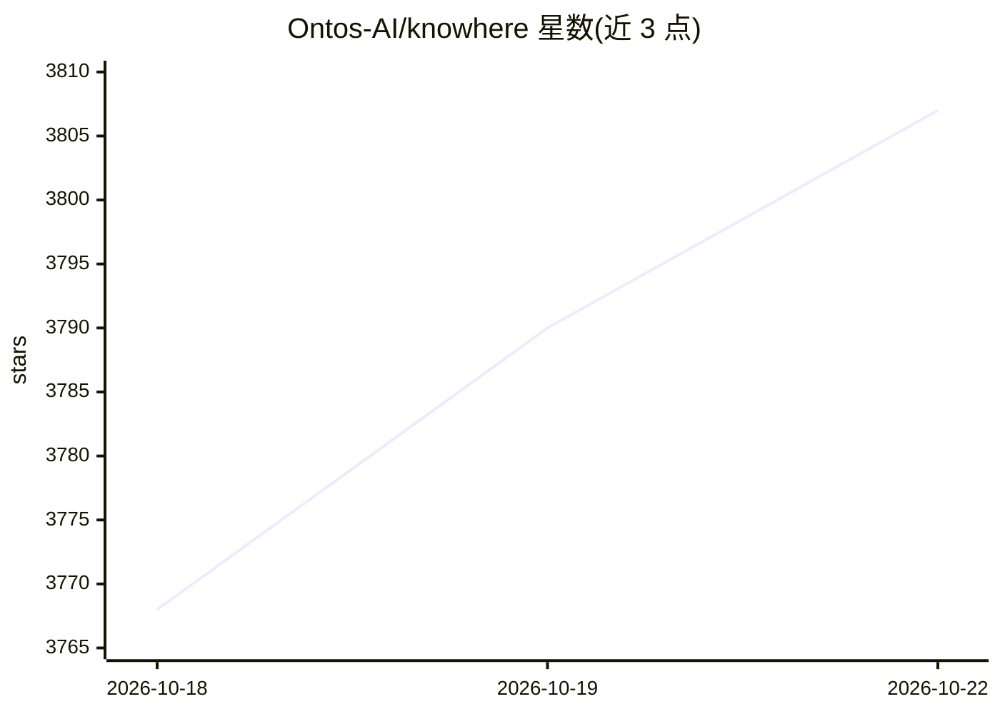

# Ontos-AI/knowhere

⭐ 3,807 · Python · Apache-2.0 · 推送 2026-10-16 · [GitHub](https://github.com/Ontos-AI/knowhere) · [官网](https://knowhereto.ai) · 组织维护

**把非结构化文档转成 AI agent 可导航检索的记忆系统**

文档解析与检索系统：摄取 PDF、Office、图片等格式的非结构化文档，经 Vision/Text 双轨解析生成统一的多层级记忆结构（章节树、跨文档图、页级引用），供 Agentic RAG、向量 RAG 及各类 agent 通过 MCP 或内置工具检索。支持自托管（Docker Compose 全栈）或托管云 API；自托管需 Python 3.11+、uv、Docker，以及数据库、Redis、S3 存储和至少一个 LLM 提供商 key；模型无关，推荐 deepseek-flash 兼任文本与视觉任务。V1 管线以 MinerU 为默认 PDF 抽取器。

## 筛选速览

| 维度 | 判定 | 备注 |
|---|---|---|
| AI 角色 | `ai-ecosystem` | LLM/agent 周边工具 |
| 许可风险 | `permissive` | Apache-2.0 |
| 部署形态 | `self-host` | docker 或自建部署 |
| 模型依赖 | — | README 未给出锁定关系 |
| 硬件要求 | — | 无带数字的原话,不猜 |
| 安装摩擦 | `low` | 无编译、无系统依赖或容器化 |
| 成熟度 | — | 结构信号不足 |

## 能力要点

- Vision/Text 双轨解析收敛为同一记忆 schema
- 多层级文档树 + 跨文档实体图谱的 agent 式检索
- 结果保留文档、章节、页码与可视来源的引用
- 通过 MCP 对外部 agent 暴露同一 corpus 工具契约

## 适用场景

- 把本地/离线文档集变成 agent 可查询的持久记忆
- 为 Agentic RAG 构建带页级引用的可溯源检索层
- 处理复杂 PDF 与 PPT 等视觉密集文档

## 场景标签

`文档解析` `RAG` `Agent 记忆` · 领域:Agent 开发

## 证据(README 行号)

> L30: **Knowhere is a document parsing and retrieval system that turns complex, dirty files into persistent, navigable me
> L123: |knowhere|**This repo.** Backend API and worker: document ingestion, parsing, graph construction, and retrieval.|
> L135: - **Agent-native Retrieval**: Built-in and MCP-connected agents explore the same corpus schema and hierarchy-aware

## 星数曲线

2026-10-18 3,768 → 2026-10-22 3,807（+39）

---
*卡片 v1 · prompt 1.4 · 生成 2026-10-20 · 置信度 high · 依据 README sha `2d71372b99e4` · [字段定义](../../DATASET.md)*
