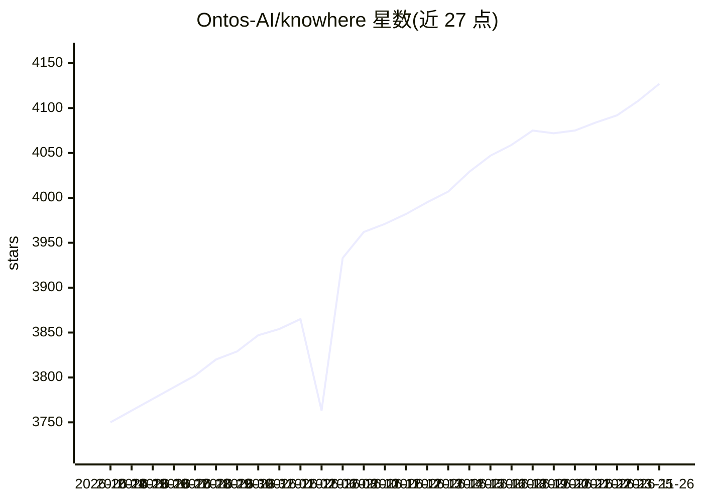

# Ontos-AI/knowhere

⭐ 4,127 · Python · Apache-2.0 · 推送 2026-11-25 · [GitHub](https://github.com/Ontos-AI/knowhere) · [官网](https://knowhereto.ai) · 组织维护 · 中文 README

**给 AI Agent 和 RAG 提供结构化文档解析与检索的文档智能基础设施**

Knowhere 是一个文档摄取与检索基础设施：按格式路由解析（PDF/PPTX 走视觉解析、其余原生解析），重建文档层级，生成带来源页码、关联资产和跨文档关系的可导航记忆。支持渐进式摄取（先发布可读基线再后台富化）、agentic 检索（recall/grep/outline/read 等语料工具，可经 MCP 或 API 被外部 Agent 调用）与传统 BM25 检索。仓库为后端 API 与 worker，官方另有 dashboard、self-hosted Docker Compose 栈与 Python/Node SDK；使用需 Python 3.11+、uv、Docker 及至少一个 LLM provider key。

## 筛选速览

| 维度 | 判定 | 备注 |
|---|---|---|
| AI 角色 | `ai-ecosystem` | LLM/agent 周边工具 |
| 许可风险 | `permissive` | Apache-2.0 |
| 部署形态 | `self-host` | docker 或自建部署 |
| 模型依赖 | locked-api |  |
| 硬件要求 | — | 无带数字的原话,不猜 |
| 安装摩擦 | `low` | 无编译、无系统依赖或容器化 |
| 成熟度 | — | 结构信号不足 |

## 能力要点

- 按格式路由解析：PDF/PPTX 用视觉模型解析，其余原生解析，输出统一 chunk schema
- 渐进式摄取：先发布可读可搜基线，层级与富化后台完成
- agent-native 检索：corpus.* 层级工具可经 MCP 或 HTTP API 供外部 Agent 调用
- 支持音频/视频语音转写及多格式图片，结果保留页面级引用

## 适用场景

- 为 RAG 管线把杂乱 PDF/PPT 解析成可检索的结构化记忆
- 让 Agent 通过层级工具探索文档语料并返回可溯源引用
- 自托管搭建企业文档解析与检索服务

## 场景标签

`文档解析` `RAG` · 领域:知识与检索

## 证据(README 行号)

> L30: **Knowhere is a document intelligence and retrieval infrastructure that turns complex, dirty files into persistent,
> L81: - **Provide the substrate**: Knowhere exposes one corpus schema and the `corpus.*` tools for exact search, fuzzy re

## 星数曲线

2026-10-24 3,750 → 2026-11-26 4,127（+377）

---
*卡片 v1 · prompt 1.4 · 生成 2026-11-23 · 置信度 high · 依据 README sha `0a04f4b65e83` · [字段定义](../../DATASET.md)*
