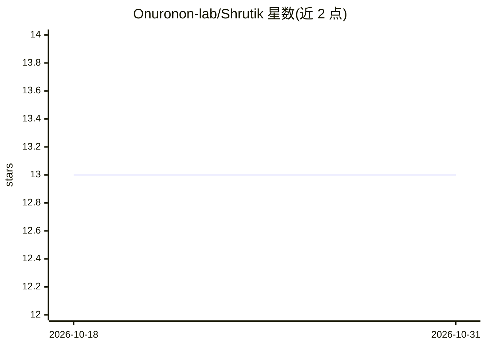

# Onuronon-lab/Shrutik

⭐ 13 · Python · NOASSERTION · 推送 2026-04-09 · [GitHub](https://github.com/Onuronon-lab/Shrutik) · [官网](https://onuronon-lab.github.io/Shrutik/) · 组织维护

**面向低资源语言的众包语音数据采集与转录平台**

开源众包平台，用于为代表性不足的语言（如孟加拉语、泰米尔语、乌尔都语等）采集语音数据并构建包容性数据集。社区贡献者通过 Web 界面录音并转录，平台内置共识机制做质量保障，并提供进度追踪与社区排行榜等游戏化元素；面向研究者提供 REST API、质量指标与多格式数据集导出，支持自托管与角色权限、审计日志。技术栈为 FastAPI + React + PostgreSQL/Redis，音频处理使用 Librosa/PyDub，异步任务用 Celery，推荐 Docker 部署。许可证为 CC BY-NC-SA 4.0，禁止未经许可的商业使用。

## 筛选速览

| 维度 | 判定 | 备注 |
|---|---|---|
| AI 角色 | `ai-ecosystem` | LLM/agent 周边工具 |
| 许可风险 | `none` | NOASSERTION |
| 部署形态 | `None` |  |
| 模型依赖 | — | README 未给出锁定关系 |
| 硬件要求 | — | 无带数字的原话,不猜 |
| 安装摩擦 | `low` | 无编译、无系统依赖或容器化 |
| 成熟度 | — | 结构信号不足 |

## 能力要点

- 众包录音与协作转录，内置质量共识机制
- REST API、实时质量指标与多格式数据集导出
- FastAPI + React + PostgreSQL/Redis，Celery 异步处理，支持 Docker 部署
- 多语言与多文字脚本支持，游戏化社区运营（进度、排行榜）

## 适用场景

- 社区为母语贡献语音数据，构建低资源语言数据集
- 研究者或组织自托管平台并导出训练用语音数据集
- 用 REST API 将语音数据采集流程接入外部系统

## 场景标签

`语音识别` · 领域:感知与多模态

## 证据(README 行号)

> L14: Shrutik (শ্রুতিক) is an open-source crowdsourcing platform designed to democratize voice technology for underrepres
> L51: - **Quality Assurance**: Built-in consensus mechanisms ensure high-quality datasets

## 星数曲线

2026-10-18 13 → 2026-10-31 13（+0）

---
*卡片 v1 · prompt 1.4 · 生成 2026-10-31 · 置信度 high · 依据 README sha `aa38cc7841f5` · [字段定义](../../DATASET.md)*
