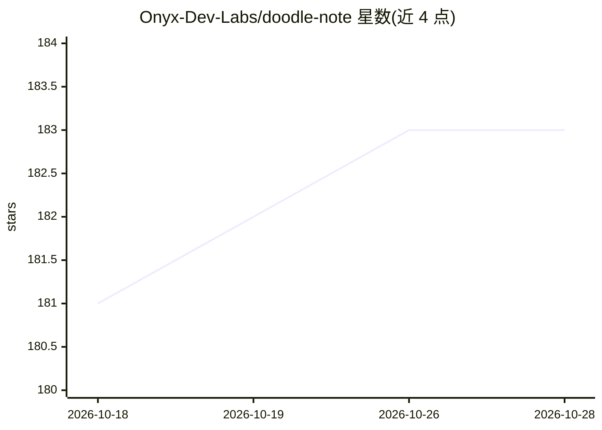

# Onyx-Dev-Labs/doodle-note

⭐ 183 · TypeScript · MIT · 推送 2026-10-27 · [GitHub](https://github.com/Onyx-Dev-Labs/doodle-note) · [官网](https://www.doodlenote.ai) · 组织维护

**本地优先的会议录音转写与 AI 笔记桌面应用**

在用户设备上采集麦克风与通话对端音频，完成设备端转写（Apple Silicon 用 Swift/FluidAudio 引擎，Windows 用打包的本地语音引擎），将转写与用户草稿笔记结合生成摘要、决策与行动项，并支持基于单次会议记录的问答。不向通话注入机器人；音频留在本地，云端同步与外部 AI 提供商均为可选（Sync 订阅 $10/月）。macOS 版正式发布，Windows 10/11 版为 beta 且安装包未签名，iOS 与 Web 工作区开发中。另含可选只读 MCP 服务器供兼容 AI 工具检索本地笔记。

## 筛选速览

| 维度 | 判定 | 备注 |
|---|---|---|
| AI 角色 | `ai-native` | 本体是模型或模型工具 |
| 许可风险 | `permissive` | MIT |
| 部署形态 | `library` | 以包/库形式分发 |
| 模型依赖 | — | README 未给出锁定关系 |
| 硬件要求 | — | 无带数字的原话,不猜 |
| 安装摩擦 | `low` | 无编译、无系统依赖或容器化 |
| 成熟度 | `idea` | |

## 能力要点

- 设备端双声道转写，保留说话人标签与时间戳
- 本地模型或自带 API key 生成摘要、决策与行动项
- 可选只读 MCP 服务器，供兼容 AI 工具检索本地笔记
- 无需账号、无会议时长限制的免费本地应用

## 适用场景

- 不引入会议机器人的情况下录制并转写通话
- 会后自动整理摘要、决策与行动项
- 跨历史会议搜索并提问
- 自托管 Sync 服务器实现多设备同步

## 场景标签

`语音识别` `知识库管理` `文档问答` · 领域:知识与检索

## 证据(README 行号)

> L12: DoodleNote captures your microphone and the other side of a call on your computer, transcribes the conversation on-
> L49: - **On-device transcription.** Apple Silicon uses the Swift/FluidAudio engine; Windows uses a packaged local speech
> L50: - **Local or bring-your-own AI.** Generate notes with a downloaded local model or your own provider key.

## 星数曲线

2026-10-18 181 → 2026-10-28 183（+2）

---
*卡片 v1 · prompt 1.4 · 生成 2026-10-22 · 置信度 high · 依据 README sha `eb611d2f6afc` · [字段定义](../../DATASET.md)*
