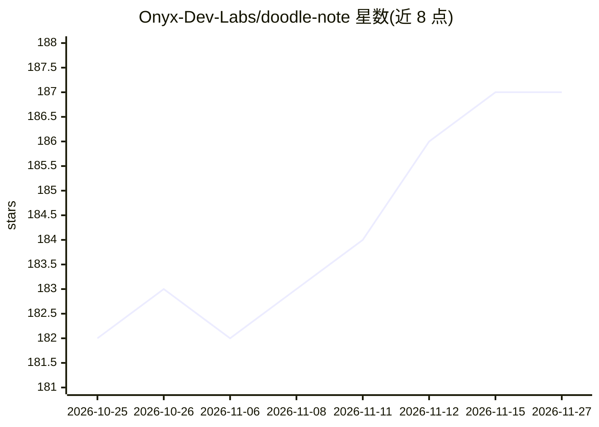

# Onyx-Dev-Labs/doodle-note

⭐ 187 · TypeScript · MIT · 推送 2026-11-23 · [GitHub](https://github.com/Onyx-Dev-Labs/doodle-note) · [官网](https://www.doodlenote.ai) · 组织维护

**本地优先的会议录制与 AI 笔记应用，录音不出设备**

面向需要记录会议的用户：捕获麦克风与通话另一侧音频，在本机完成转录，并把转录与手写粗笔记合并为含摘要、决定事项、行动项的会议记录。无会议机器人入会，音频保留在本地；可选付费云同步仅上传所选内容。内置 Bark 听写（macOS Apple Silicon）。Windows 版为 beta 且未签名；iOS 与 Web 工作区处于开发中。本地应用免费、无需账号、无会议次数限制。

## 筛选速览

| 维度 | 判定 | 备注 |
|---|---|---|
| AI 角色 | `ai-native` | 本体是模型或模型工具 |
| 许可风险 | `permissive` | MIT |
| 部署形态 | `library` | 以包/库形式分发 |
| 模型依赖 | — | README 未给出锁定关系 |
| 硬件要求 | — | 无带数字的原话,不猜 |
| 安装摩擦 | `low` | 无编译、无系统依赖或容器化 |
| 成熟度 | `idea` | |

## 能力要点

- 设备端转录：macOS 用 Swift/FluidAudio 引擎，Windows 用打包的本地语音引擎
- 本地模型或自带 API key 两种方式生成 AI 笔记
- 可选、只读的 MCP server，让兼容 AI 工具检索本地笔记与转录
- Bark 听写：任意应用内语音输入，本机识别且不保留音频

## 适用场景

- 不用机器人入会地录制并转录线上会议
- 把转录和粗笔记一键整理成带行动项的会议纪要
- 对历史会议记录提问、跨会议检索

## 场景标签

`知识库管理` `语音识别` · 领域:知识与检索

## 证据(README 行号)

> L7:  Privacy-first, local-first meeting capture, AI notes, and built-in Bark dictation. No meeting bot required.
> L20: DoodleNote captures your microphone and the other side of a call on your computer, transcribes the conversation on-
> L81: - **On-device transcription.** Apple Silicon uses the Swift/FluidAudio engine; Windows uses a packaged local speech

## 星数曲线

2026-10-25 182 → 2026-11-27 187（+5）

---
*卡片 v1 · prompt 1.4 · 生成 2026-11-26 · 置信度 mid · 依据 README sha `b2283095e9f1` · [字段定义](../../DATASET.md)*
