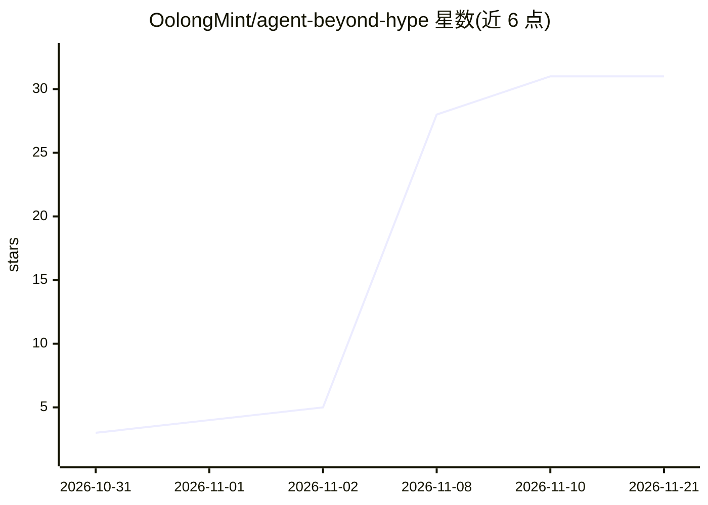

# OolongMint/agent-beyond-hype

⭐ 31 · NOASSERTION · 推送 2026-10-25 · [GitHub](https://github.com/OolongMint/agent-beyond-hype) · 个人维护 · 中文 README

**AI Agent 使用者的思考文集与可复用任务模板**

由个人维护的思考文章与实践提案仓库：主张以可验证交付而非新概念评估 Agent，提供任务契约、实践手册、交接状态、验收清单、实验报告等 Markdown 模板，覆盖上下文管理、工具选择、成本核算（每次合格交付成本）与失败恢复。README 明确声明目前无实测性能数据，定位为可讨论的观点与模板，欢迎失败案例与对照实验贡献。文章按 CC BY 4.0 许可，经 AI 协助整理。

## 筛选速览

| 维度 | 判定 | 备注 |
|---|---|---|
| AI 角色 | `ai-knowledge` | 知识聚合/清单类 |
| 许可风险 | `none` | NOASSERTION |
| 部署形态 | `None` |  |
| 模型依赖 | — | README 未给出锁定关系 |
| 硬件要求 | — | 无带数字的原话,不猜 |
| 安装摩擦 | `low` | 无编译、无系统依赖或容器化 |
| 成熟度 | `idea` | |

## 能力要点

- 任务契约模板：目标/输入/权限/预算/验收/恢复六要素
- 提出 harness 概念框架与 Agent 最小理解框架
- 每次合格交付成本的计算口径与对照实验模板
- 来源与校准文档区分资料支持、观点与待验证内容

## 适用场景

- 把一句想法整理成可执行、可验收的 Agent 任务
- 为跨会话/compact/reset 场景维护交接状态
- 设计单/多 Agent 与上下文策略的对照实验

## 场景标签

`提示工程` `教程课程` · 领域:Agent 开发

## 证据(README 行号)

> L15: 这里提供一套可讨论的观点和可复用的 Markdown 模板。项目目前是**思考文章与实践提案**，尚无实测性能数据；欢迎提交反例与实验。
> L81: |文件|用途|
> L89: |填写样例|用发布说明任务演示上述方法|

## 星数曲线

2026-10-31 3 → 2026-11-21 31（+28）

---
*卡片 v1 · prompt 1.4 · 生成 2026-11-18 · 置信度 high · 依据 README sha `8fd864b1db71` · [字段定义](../../DATASET.md)*
