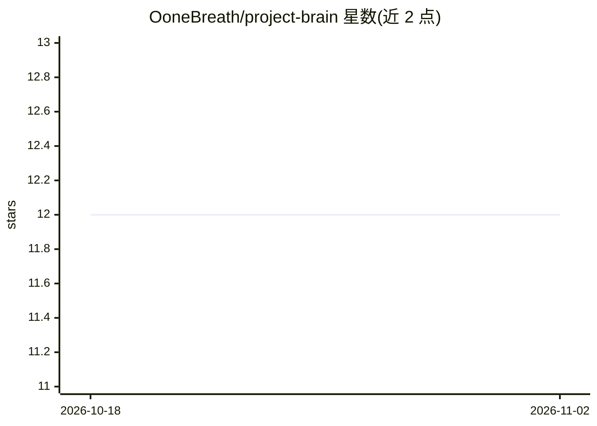

# OoneBreath/project-brain

⭐ 12 · Python · MIT · 推送 2026-10-30 · [GitHub](https://github.com/OoneBreath/project-brain) · [官网](https://fixflex.co.uk/project-brain.html) · 个人维护

**给 AI 编程 agent 的持久化项目记忆：Markdown 地图+索引**

面向 Claude Code、Cursor、Windsurf 等文件读取型编程 agent 的记忆方案：以 `.project-brain/` 目录的纯 Markdown 文件为载体，包含手工维护的 index.md 与确定性生成的 index.compact，agent 启动时先读小索引、按指针按需加载细节。机制上提供状态标记（✓/✗/⚠/⨯）、版本化留痕、HOT/WARM/COLD 分层、决策日志、`trust:` 信任分级、`brain-check` 结构校验器与冲突检测。零运行时依赖（仅 Python 3 标准库），支持导出到 claude.ai/Gemini/ChatGPT 并默认脱敏基础设施信息。

## 筛选速览

| 维度 | 判定 | 备注 |
|---|---|---|
| AI 角色 | `ai-ecosystem` | LLM/agent 周边工具 |
| 许可风险 | `permissive` | MIT |
| 部署形态 | `None` |  |
| 模型依赖 | — | README 未给出锁定关系 |
| 硬件要求 | — | 无带数字的原话,不猜 |
| 安装摩擦 | `low` | 无编译、无系统依赖或容器化 |
| 成熟度 | — | 结构信号不足 |

## 能力要点

- index.md + 生成的 index.compact 索引优先加载，按需读取细节文件
- 状态标记区分 verified/failed/in-progress/superseded，避免重复已完成工作
- brain-check 校验指针解析、状态同步、跨项目守护与冲突检测
- 零运行时依赖，纯 Markdown 可 grep、可提交进仓库

## 适用场景

- 跨会话让 AI 编程助手记住项目栈、决策与陷阱，不再重复解释
- 多项目并行时防止 agent 混淆技术栈细节
- 导出项目记忆给 claude.ai / ChatGPT 等网页端工具继续对话

## 场景标签

`Agent 记忆` · 领域:Agent 开发

## 证据(README 行号)

> L10: Project Brain is a skill that gives your AI agent a small, navigable **map** of your projects — their
> L14: It is **not** a database, a server, or another AI wrapper. It's a convention plus a skill: a
> L17: Works across tools — **Claude Code · Cursor · Windsurf**, or any file-reading agent.

## 星数曲线

2026-10-18 12 → 2026-11-02 12（+0）

---
*卡片 v1 · prompt 1.4 · 生成 2026-11-01 · 置信度 high · 依据 README sha `0117be90ad15` · [字段定义](../../DATASET.md)*
