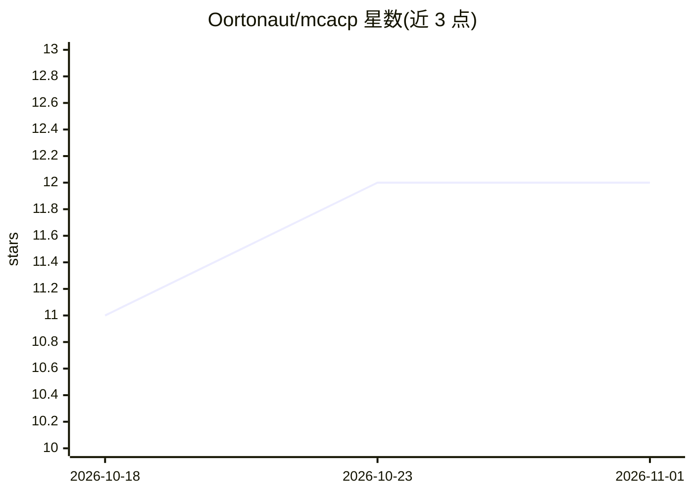

# Oortonaut/mcacp

⭐ 12 · TypeScript · Apache-2.0 · 推送 2026-02-01 · [GitHub](https://github.com/Oortonaut/mcacp) · 个人维护

**MCP 与 ACP 协议桥接服务器：任意 MCP 客户端操控 ACP 编程 agent**

以 MCP 服务器形式实现的协议桥：代表 MCP 宿主（Claude Code、Zed、VS Code 等）说 Agent Client Protocol，使用户在单一对话窗口内启动、管理并与 ACP 编程 agent 交互，构成多 agent 控制平面。暴露 22 个工具，覆盖注册表检索安装、agent 生命周期、会话持久化与恢复、交互轮询、权限策略（allow_all/deny_all/elicit/operator）与状态管理。会话持久化到磁盘，可 load_session 恢复。通过 npm 全局安装或 npx 直接运行，Apache-2.0 许可。

## 筛选速览

| 维度 | 判定 | 备注 |
|---|---|---|
| AI 角色 | `ai-ecosystem` | LLM/agent 周边工具 |
| 许可风险 | `permissive` | Apache-2.0 |
| 部署形态 | `library` | 以包/库形式分发 |
| 模型依赖 | — | README 未给出锁定关系 |
| 硬件要求 | — | 无带数字的原话,不猜 |
| 安装摩擦 | `low` | 无编译、无系统依赖或容器化 |
| 成熟度 | — | 结构信号不足 |

## 能力要点

- 以 MCP 服务器形式桥接任意 MCP 客户端与 ACP 编程 agent
- 22 个工具覆盖注册表、生命周期、会话、交互、状态五组
- 四级权限策略，支持 MCP elicitation 交互式授权与 operator 模式回退
- 会话持久化到磁盘，可重启后恢复继续

## 适用场景

- 在 Claude Code、Zed、VS Code 等任一 MCP 客户端中运行 Gemini CLI、Codex 等 ACP agent
- 并行运行多个 agent 对比同一任务的结果
- 构建一个写码、一个评审、一个测试的多 agent 流水线
- 通过对话从 ACP 注册表发现并安装 agent

## 场景标签

`多智能体` · 领域:Agent 开发

## 证据(README 行号)

> L3: **Bridge any MCP client to any ACP coding agent.**
> L5: MCACP is an MCP server that speaks the Agent Client Protocol on behalf of your MCP host. It lets Claude Code, Zed, V
> L71: MCACP exposes 22 tools organized into five groups.

## 星数曲线

2026-10-18 11 → 2026-11-01 12（+1）

---
*卡片 v1 · prompt 1.4 · 生成 2026-11-01 · 置信度 high · 依据 README sha `257940b0dcd4` · [字段定义](../../DATASET.md)*
