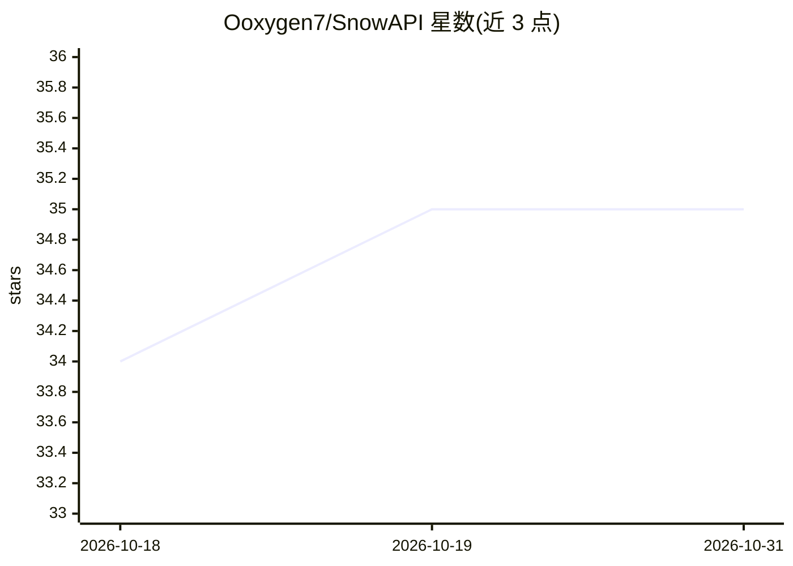

# Ooxygen7/SnowAPI

⭐ 35 · Go · AGPL-3.0 · 推送 2026-10-02 · [GitHub](https://github.com/Ooxygen7/SnowAPI) · 个人维护 · 中文 README

**多模型统一 API 网关：聚合上游、计费订阅与运营控制台**

基于 QuantumNous/new-api 修改的 Go + React 一体化 LLM 网关平台：在统一入口后接入多家上游供应商，提供 OpenAI Chat Completions/Responses 与 Anthropic Messages 协议入口及协议转换；覆盖渠道调度池、优先级权重、故障转移与负载均衡，以及按 Token/请求计费、订阅权益、额度结算、邀请码、LinuxDO OAuth、Linux Do Credit 充值。含模型健康度可视化、IP 审计封禁等运营功能。通过 Docker Compose 部署，支持 SQLite/MySQL/PostgreSQL，许可证为 AGPL-3.0 并保留上游归属。

## 筛选速览

| 维度 | 判定 | 备注 |
|---|---|---|
| AI 角色 | `ai-ecosystem` | LLM/agent 周边工具 |
| 许可风险 | `viral` | AGPL-3.0 |
| 部署形态 | `self-host` | docker 或自建部署 |
| 模型依赖 | — | README 未给出锁定关系 |
| 硬件要求 | — | 无带数字的原话,不猜 |
| 安装摩擦 | `low` | 无编译、无系统依赖或容器化 |
| 成熟度 | — | 结构信号不足 |

## 能力要点

- 统一协议入口（/v1/chat/completions、/v1/responses、/v1/messages）与跨渠道调度池、自动故障转移
- 按 Token 或请求计费、订阅分组升级、兑换码与 Linux Do Credit 充值
- 模型健康度、成功率、小时趋势可视化与 IP 多国家/多 ASN 审计封禁
- 七种界面语言与浅色/深色主题，Docker Compose 一键部署

## 适用场景

- 为应用提供多供应商模型的统一 OpenAI/Anthropic 兼容入口
- 搭建团队共享或对外运营的 API 计费平台
- 管理 API 密钥、额度、订阅权益与访问控制

## 场景标签

`模型网关` · 领域:Agent 开发

## 证据(README 行号)

> L20: SnowAPI 是为 AI 模型聚合、分发和商业化而设计的一体化平台。它在统一入口后连接不同上游供应商，为应用提供 OpenAI Chat Completions、OpenAI Responses 与 Anthropic Mess
> L22: 项目包含完整的 Go 后端、React 控制台、数据库模型、协议转换层、Docker 构建与生产部署示例，可用于个人模型网关、团队共享服务或面向用户的 API 平台。

## 星数曲线

2026-10-18 34 → 2026-10-31 35（+1）

---
*卡片 v1 · prompt 1.4 · 生成 2026-10-25 · 置信度 high · 依据 README sha `4f054fad2c42` · [字段定义](../../DATASET.md)*
