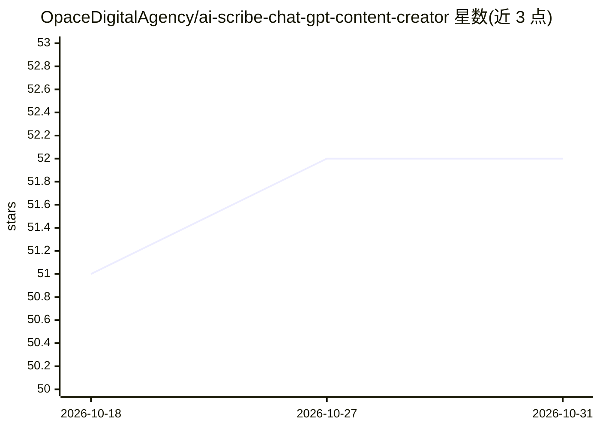

# OpaceDigitalAgency/ai-scribe-chat-gpt-content-creator

⭐ 52 · PHP · GPL-3.0 · 推送 2026-09-05 · [GitHub](https://github.com/OpaceDigitalAgency/ai-scribe-chat-gpt-content-creator) · [官网](https://opace.agency/services/web-design/wordpress-development) · 组织维护

**WordPress 用户的 SEO 文章生成与拟人化写作插件**

面向 WordPress 的开源 SEO 内容生成插件，接入 OpenAI、Anthropic Claude 与 Google Gemini，通过 11 步向导（标题、关键词、大纲、正文、问答、SEO 元数据）或 Express 模式生成长文，输出草稿、发布文章或 shortcode。需配合独立的 Opace AI Hub 插件统一管理加密密钥、模型发现与成本报表。支持 Image Studio 配图生成、可编辑提示词、SEO 插件元数据对接（Yoast/Rank Math 等）。用户需自行审核发布内容。

## 筛选速览

| 维度 | 判定 | 备注 |
|---|---|---|
| AI 角色 | `ai-native` | 本体是模型或模型工具 |
| 许可风险 | `viral` | GPL-3.0 |
| 部署形态 | `None` |  |
| 模型依赖 | locked-api |  |
| 硬件要求 | — | 无带数字的原话,不猜 |
| 安装摩擦 | `low` | 无编译、无系统依赖或容器化 |
| 成熟度 | — | 结构信号不足 |

## 能力要点

- 11 步向导 + Express 模式生成 SEO 长文，全程单一会话保留上下文
- 支持 OpenAI/Anthropic/Gemini 三家，模型列表从账户实时发现
- Image Studio 生成与管理 OpenAI/Gemini 配图
- 依赖 Opace AI Hub 集中管理 AES-256-CBC 加密密钥与成本报表

## 适用场景

- 在 WordPress 内从想法生成完整 SEO 优化文章
- 为文章生成配图并管理 SEO 元数据与焦点关键词
- 在发布前以草稿形式保存并编辑 AI 生成的草稿

## 场景标签

`AI 写作` `图像生成` · 领域:内容生成

## 证据(README 行号)

> L29: AI Scribe is a free, open-source SEO AI writer, content generator and humaniser. It writes long-form,
> L31: idea through titles, keywords, outline, body, conclusion, Q&A and SEO meta; Express mode starts with one
> L37: - Guides an article through titles, keywords, outline, introduction, tagline, body, conclusion, Q&A,

## 星数曲线

2026-10-18 51 → 2026-10-31 52（+1）

---
*卡片 v1 · prompt 1.4 · 生成 2026-10-24 · 置信度 high · 依据 README sha `027cfd6312d6` · [字段定义](../../DATASET.md)*
