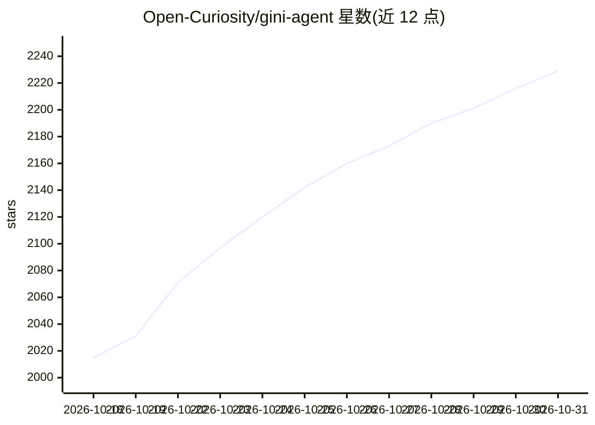

# Open-Curiosity/gini-agent

⭐ 2,229 · TypeScript · MIT · 推送 2026-07-18 · [GitHub](https://github.com/Open-Curiosity/gini-agent) · 组织维护

**个人 AI agent 运行时：带记忆与技能学习的本地网关**

以单个 Bun 进程为网关的个人 agent 系统：作为对话、运行、任务、审批、记忆、技能、任务调度、工具与审计事件的系统记录，Next.js Web、CLI、Expo 移动端、MCP 与消息桥接均为同一 /api/* 契约的客户端。支持多模型提供商（OpenAI/Anthropic/Bedrock/Azure/OpenRouter/DeepSeek/Codex 及任意 OpenAI 兼容本地服务器），默认本地嵌入、重排与语音转文字，记忆与技能可从任务结果学习并经人工门控。交互以聊天内嵌控制卡（安全凭据字段、登录接力、选择提示、发送前确认）为核心机制；消息桥接（Telegram/Discord）未被积极开发。macOS 提供安装脚本与自启动，Linux 需手动 setup/start。

## 筛选速览

| 维度 | 判定 | 备注 |
|---|---|---|
| AI 角色 | `ai-native` | 本体是模型或模型工具 |
| 许可风险 | `permissive` | MIT |
| 部署形态 | `None` |  |
| 模型依赖 | local-ok | 支持本地模型 |
| 硬件要求 | — | 无带数字的原话,不猜 |
| 安装摩擦 | `low` | 无编译、无系统依赖或容器化 |
| 成熟度 | — | 结构信号不足 |

## 能力要点

- 单 Bun 进程网关统一承载状态、agent 循环、工具、记忆与任务调度，多客户端共享契约
- 记忆保留/召回与基于任务结果的两层奖励技能学习（含每日回顾与人工门控）
- 聊天内嵌交互控制：安全凭据卡、浏览器登录接力、选择提示、发送前确认
- 本地嵌入/重排/语音转文字默认运行，模型缓存于 ~/.gini/models

## 适用场景

- 在本机或服务器上运行一个可跨手机/桌面交互的个人 agent
- 让 agent 执行多步任务、定时作业并在关键步骤请求我的确认
- 从 openclaw 迁移已有的 agent、记忆与技能数据

## 场景标签

`Agent 框架` `Agent 记忆` `AI 助手` `模型网关` · 领域:Agent 开发

## 证据(README 行号)

> L3: Gini Agent is a personal agent that remembers, improves, and runs without forcing you to read a log line.
> L5: Gini is not just a chat box, CLI, messaging bot, or pile of tools. Chat is an interaction surface. The runtime is th
> L33: Gini's **runtime is the gateway**: a single Bun process per instance owns state and performs work. The Next.js web 

## 星数曲线

2026-10-18 2,015 → 2026-10-31 2,229（+214）

---
*卡片 v1 · prompt 1.4 · 生成 2026-10-21 · 置信度 high · 依据 README sha `ddee598e118a` · [字段定义](../../DATASET.md)*
