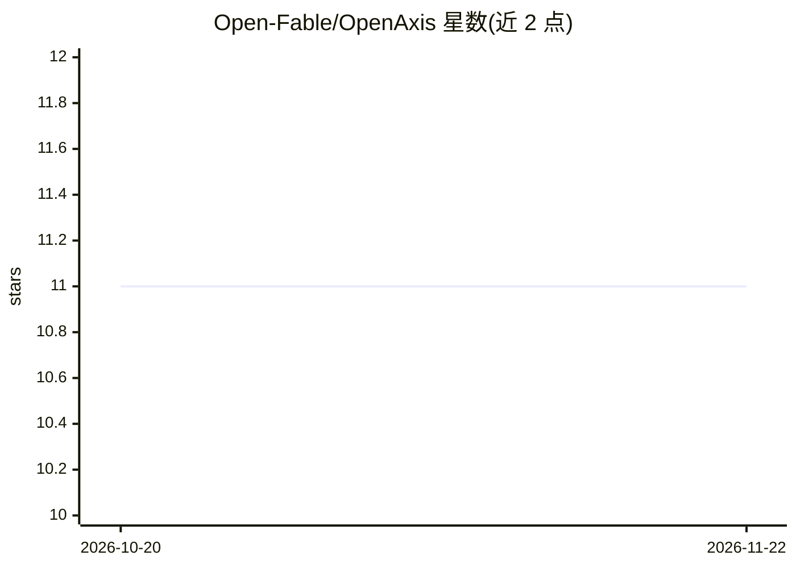

# Open-Fable/OpenAxis

⭐ 11 · TypeScript · MIT · 推送 2026-08-01 · [GitHub](https://github.com/Open-Fable/OpenAxis) · [官网](https://open-fable.github.io/OpenAxis/) · 个人维护

**macOS 单窗口 AI 工作台：聊天、多智能体编排与代码/设计工具**

基于 Electron 的 macOS 本地 AI 工作台，把五个侧边栏槽位合并在一个窗口：聊天、多智能体编排器、OpenCode 代码代理、OpenWork 项目工作区与 Open Design 视觉设计工具，共享记忆与单一 LLM 代理（127.0.0.1:9999）。编排器把自然语言任务规划为可视化 DAG，各智能体自主执行并自我纠错。支持 Anthropic、OpenAI、OpenRouter、Ollama、Gemini 及任何 OpenAI 兼容提供方；API 密钥以 AES-256-GCM 加密存储。限制：仅支持 macOS 14+（Apple Silicon），.dmg 未签名需绕过 Gatekeeper，个人资料跨会话记忆尚在维护中。

## 筛选速览

| 维度 | 判定 | 备注 |
|---|---|---|
| AI 角色 | `ai-native` | 本体是模型或模型工具 |
| 许可风险 | `permissive` | MIT |
| 部署形态 | `desktop` | 安装包/桌面程序 |
| 模型依赖 | local-ok | 支持本地模型 |
| 硬件要求 | — | 无带数字的原话,不猜 |
| 安装摩擦 | `low` | 无编译、无系统依赖或容器化 |
| 成熟度 | — | 结构信号不足 |

## 能力要点

- 多智能体编排器：自然语言任务规划为可视化 DAG 并实时执行、自我纠错
- 单一本地 LLM 代理统一 OpenAI 兼容端点，含 DeepSeek/Anthropic 提示缓存策略
- 五个工具槽位共享执行状态与会话记忆，密钥 AES-256-GCM 加密
- OpenCode/OpenWork/Open Design 以上游工具形式克隆运行，非 fork

## 适用场景

- 在单个 macOS 窗口内管理多提供方的模型聊天
- 用自然语言让多智能体团队产出落地页、OpenAPI 规范等交付物
- 结合代码代理与设计工具完成开发到设计的工作流

## 场景标签

`多智能体` `聊天机器人` `编码 Agent` · 领域:Agent 开发

## 证据(README 行号)

> L5: A local AI workspace: chat with any model, orchestrate a team of agents that builds real deliverables, and switch be
> L31: The **multi-agent orchestrator** is the headliner. It's an interactive assistant: describe what you want in plain l

## 星数曲线

2026-10-20 11 → 2026-11-22 11（+0）

---
*卡片 v1 · prompt 1.4 · 生成 2026-11-19 · 置信度 high · 依据 README sha `467c916daf9f` · [字段定义](../../DATASET.md)*
