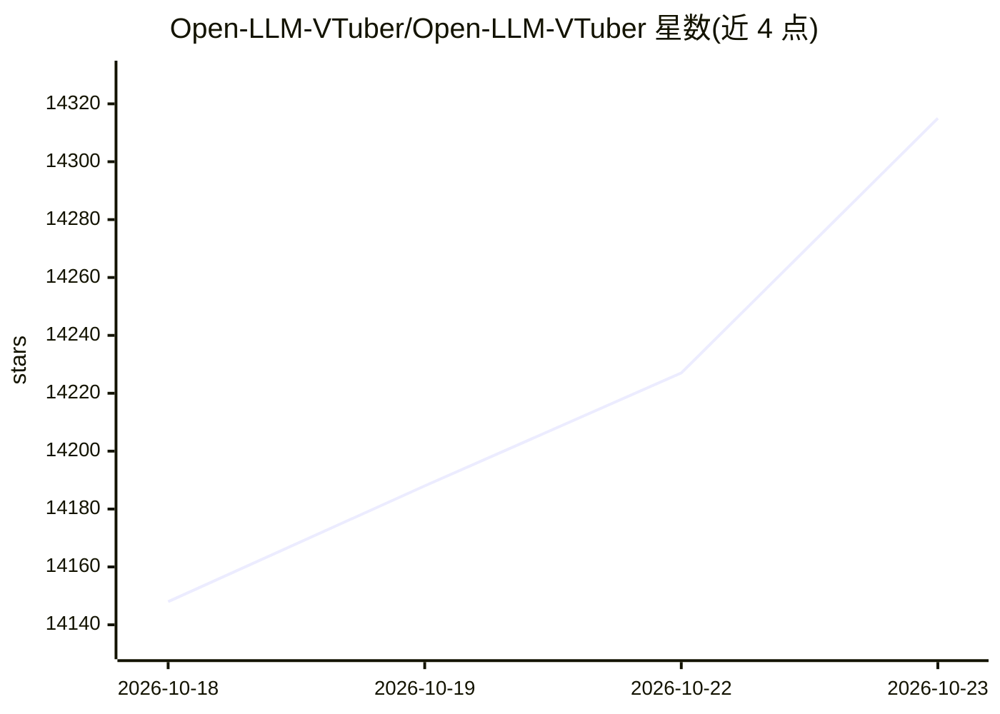

# Open-LLM-VTuber/Open-LLM-VTuber

⭐ 14,315 · Python · NOASSERTION · 推送 2026-05-15 · [GitHub](https://github.com/Open-LLM-VTuber/Open-LLM-VTuber) · [官网](https://open-llm-vtuber.github.io/) · 组织维护 · 中文 README

**本地运行的语音交互 AI 陪伴：Live2D 形象+免手操作对话**

跨平台语音交互 AI 陪伴项目：整合 LLM 推理、语音识别与语音合成方案，支持实时语音对话、语音打断、视觉感知（摄像头/截屏/录屏）与 Live2D 虚拟形象。提供网页版与桌面客户端两种模式，桌面客户端支持透明背景桌宠模式。全部功能可完全离线运行于本地。通过配置文件切换各功能模块，可自定义 Live2D 模型、人设 Prompt 与声音克隆。安装依赖 uv，v1.0.0 存在破坏性变更需重新部署。

## 筛选速览

| 维度 | 判定 | 备注 |
|---|---|---|
| AI 角色 | `ai-native` | 本体是模型或模型工具 |
| 许可风险 | `dual` | NOASSERTION |
| 部署形态 | `None` |  |
| 模型依赖 | local-ok | 支持本地模型 |
| 硬件要求 | — | 无带数字的原话,不猜 |
| 安装摩擦 | `medium` | 含编译或系统依赖之一 |
| 成熟度 | `idea` | |

## 动量与使用信号

- 维护:`maintenance` — 距上次 push 156.1 天,年发版 0,27 位贡献者
- 涨星:近 1 天 **+26**(自 20261016 起算)
- 平台:WINDOWS / MACOS / LINUX · 协议:OPENAI-API / OLLAMA

## 能力要点

- 完全离线模式：本地模型运行，对话数据不出设备
- 语音打断（免耳机）与视觉感知（摄像头/屏幕截图）
- Live2D 表情映射、桌宠模式与触摸交互
- 模块化可扩展：LLM/ASR/TTS 模块经配置文件切换

## 适用场景

- 在本机搭建可语音对话的 Live2D 虚拟角色陪伴
- 作为透明背景桌宠挂在屏幕上随时互动
- 离线环境下保障隐私的语音 AI 陪伴

## 场景标签

`语音 Agent` · 领域:对话与助手

## 证据(README 行号)

> L35: **Open-LLM-VTuber** is a unique **voice-interactive AI companion** that not only supports **real-time voice convers
> L70:  - 🤖 Large Language Models (LLM): Ollama, OpenAI (and any OpenAI-compatible API), Gemini, Claude, Mistral, DeepSeek
> L54: - 🔒 **Offline mode support**: Run completely offline using local models - no internet required. Your conversations 

## 星数曲线

2026-10-18 14,148 → 2026-10-23 14,315（+167）

---
*卡片 v1 · prompt 1.4 · 生成 2026-10-18 · 置信度 high · 依据 README sha `d048242b9db8` · [字段定义](../../DATASET.md)*
