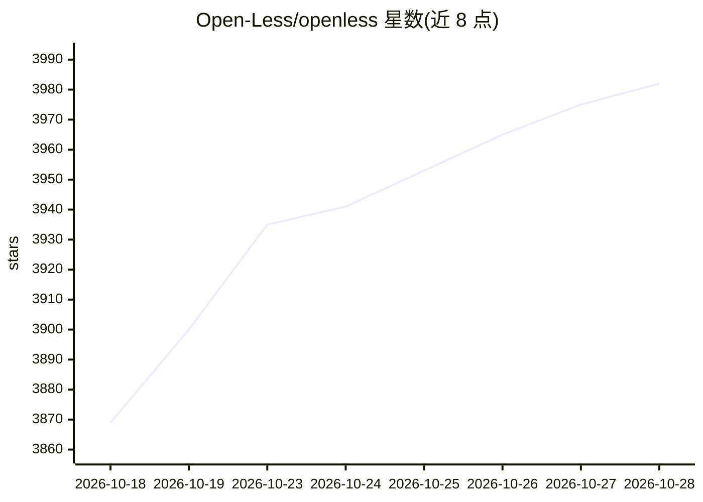

# Open-Less/openless

⭐ 3,989 · Rust · AGPL-3.0 · 推送 2026-10-28 · [GitHub](https://github.com/Open-Less/openless) · [官网](https://github.com/appergb/openless) · 组织维护 · 中文 README

**开源跨平台语音输入工具：按住热键说话，光标处得到润色后文字**

面向 macOS/Windows（Linux 另有原生宿主）的语音输入应用：按住全局热键说话，经云端或本地 ASR 转写、再由可选润色模型按所选风格包整理，逐字符流式插入光标处，失败时回退剪贴板。特色是 AI-prompt 模式，将口语整理为可直接粘贴给 ChatGPT/Claude/Cursor 的结构化提示词。支持十余家 ASR 与润色厂商或任意 OpenAI 兼容端点，凭据自备，数据本地存储；提供风格包市场、可学习词典与热词。不做问答与任务执行，每次转写相互独立。

## 筛选速览

| 维度 | 判定 | 备注 |
|---|---|---|
| AI 角色 | `ai-native` | 本体是模型或模型工具 |
| 许可风险 | `viral` | AGPL-3.0 |
| 部署形态 | `desktop` | 安装包/桌面程序 |
| 模型依赖 | locked-api |  |
| 硬件要求 | — | 无带数字的原话,不猜 |
| 安装摩擦 | `medium` | 含编译或系统依赖之一 |
| 成熟度 | — | 结构信号不足 |

## 能力要点

- 云端 ASR 覆盖火山引擎/讯飞/阿里百炼/腾讯混元等十余家，本地含 Qwen3-ASR 与 Whisper 变体
- 风格包市场：自定义系统提示词，热键切换，一键安装社区包
- 逐字符流式插入，应用不支持时自动回退一次性粘贴
- 词典热词与纠正学习（需用户确认），光标上下文可选读取

## 适用场景

- 口述并整理成给 ChatGPT/Claude/Cursor 的结构化提示词
- 语音起草邮件、规范文档和长消息
- 口述代码注释、commit 信息与 PR 描述
- 不想打字但需要成文的场景

## 场景标签

`语音识别` · 领域:感知与多模态

## 证据(README 行号)

> L73: Place your cursor in any text field — ChatGPT, Claude, Cursor, Notion, an email draft, a chat box — press a single 
> L149: - The pipeline is: speech → transcript → cleanup → insertion at the cursor, with a clipboard fallback on failure.
> L169: - **Cloud ASR**: Volcengine streaming ASR (bigasr), Tencent Cloud Hunyuan realtime ASR (Hy-ASR), iFlytek realtime 

## 星数曲线

2026-10-18 3,869 → 2026-10-28 3,982（+113）

---
*卡片 v1 · prompt 1.4 · 生成 2026-10-21 · 置信度 high · 依据 README sha `7b3db9661de4` · [字段定义](../../DATASET.md)*
