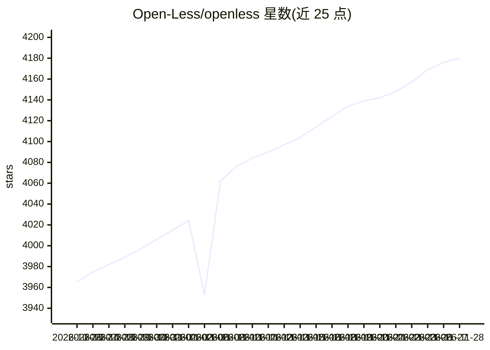

# Open-Less/openless

⭐ 4,180 · Rust · AGPL-3.0 · 推送 2026-11-27 · [GitHub](https://github.com/Open-Less/openless) · [官网](https://openless.top) · 个人维护 · 中文 README

**开源 AI 语音输入工具：按住说话，松开输出润色文本**

跨平台开源语音输入应用，覆盖 macOS、Windows、Linux、Android、iOS 与 HarmonyOS。按住快捷键说话，松开后将语音转为去除口头语、保留约束条件的结构化文本或可直接使用的 AI 提示词。采用两段式（ASR+LLM）或单步多模态音频模型管线，可组合约 30 种语音引擎与 20 余种 LLM，支持本地离线运行；提供风格包市场、按应用自动切换风格、个人词典、最长 1 小时连续录音，以及手机经局域网向电脑光标处输入。桌面端通过安装包或 Homebrew cask 安装。

## 筛选速览

| 维度 | 判定 | 备注 |
|---|---|---|
| AI 角色 | `ai-native` | 本体是模型或模型工具 |
| 许可风险 | `viral` | AGPL-3.0 |
| 部署形态 | `None` |  |
| 模型依赖 | — | README 未给出锁定关系 |
| 硬件要求 | — | 无带数字的原话,不猜 |
| 安装摩擦 | `low` | 无编译、无系统依赖或容器化 |
| 成熟度 | — | 结构信号不足 |

## 能力要点

- 按住快捷键说话，松开即得去口头语、结构化的文本或提示词
- 两段式管线可组合约 30 种 ASR 引擎与 20+ LLM，含本地离线引擎
- 风格包市场与按应用/应用类别自动切换风格（Auto Style）
- 最长 1 小时连续录音与 10–20 段背靠背听写后台排队

## 适用场景

- 对着 AI 编程助手口头描述功能改动或 bug 修复细节
- 写邮件、PR、文档时用语音输入并自动润色成正式文风
- 在无网络或不愿上传数据的环境下用本地模型做语音输入
- 用手机浏览器经局域网向电脑光标处语音输入

## 场景标签

`语音识别` `AI 写作` · 领域:内容生成

## 证据(README 行号)

> L7:  Hold a hotkey and talk. Turn complete spoken thoughts into clean, structured text or ready-to-run AI prompts straig
> L40: OpenLess is a cross-platform, open-source AI voice-input app covering **macOS, Windows, Linux, Android, iOS, and Ha
> L133:  - **Two-Stage (ASR + LLM)**: Mix Volcengine (Doubao ASR), Alibaba Bailian, iFlytek RTASR, Tencent Hunyuan, Google

## 星数曲线

2026-10-26 3,965 → 2026-11-28 4,180（+215）

---
*卡片 v1 · prompt 1.4 · 生成 2026-11-28 · 置信度 high · 依据 README sha `cfcab79defe1` · [字段定义](../../DATASET.md)*
