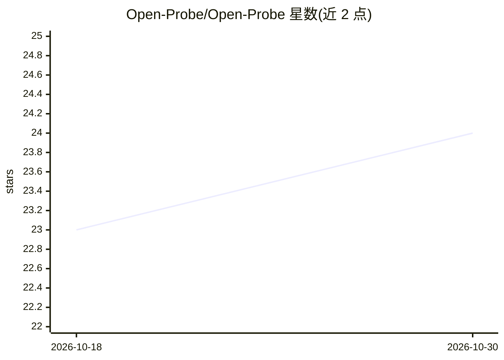

# Open-Probe/Open-Probe

⭐ 24 · Python · MIT · 推送 2026-10-08 · [GitHub](https://github.com/Open-Probe/Open-Probe) · 组织维护

**开源 agent 深度网络搜索系统，回答复杂问题**

基于 LangGraph 编排的 agent 深度搜索系统：主节点路由计划、搜索、代码执行、求解、重规划等节点，执行多步网络搜索并合成最终答案；支持自适应重规划、失败反思、Jina 重排序、查询改写与本地 REPL 代码执行。默认使用 Google Gemini，亦支持任何 OpenAI 兼容模型。提供 Next.js Web 界面、FastAPI 后端、CLI 与内置评测框架；需自备 LLM、Serper、Jina 等 API key。

## 筛选速览

| 维度 | 判定 | 备注 |
|---|---|---|
| AI 角色 | `ai-native` | 本体是模型或模型工具 |
| 许可风险 | `permissive` | MIT |
| 部署形态 | `library` | 以包/库形式分发 |
| 模型依赖 | — | README 未给出锁定关系 |
| 硬件要求 | — | 无带数字的原话,不猜 |
| 安装摩擦 | `low` | 无编译、无系统依赖或容器化 |
| 成熟度 | — | 结构信号不足 |

## 能力要点

- LangGraph 编排的计划/搜索/代码执行/求解/重规划多节点工作流
- 支持 Google Gemini 与任意 OpenAI 兼容模型
- Jina 重排序与可选本地 reranker，含查询改写
- 内置搜索质量评测框架

## 适用场景

- 让 agent 多步网络搜索并回答复杂研究型问题
- 复现与评测深度搜索系统的回答质量
- 通过 Web UI 或 CLI 使用深度搜索 agent

## 场景标签

`科研工具` · 领域:学习与行业

## 证据(README 行号)

> L3: OpenProbe is an opensource agent-based search system that performs deep web searches to answer complex questions. Yo
> L33: The system uses LangGraph to orchestrate the search process:

## 星数曲线

2026-10-18 23 → 2026-10-30 24（+1）

---
*卡片 v1 · prompt 1.4 · 生成 2026-10-27 · 置信度 mid · 依据 README sha `4110e5b2812c` · [字段定义](../../DATASET.md)*
