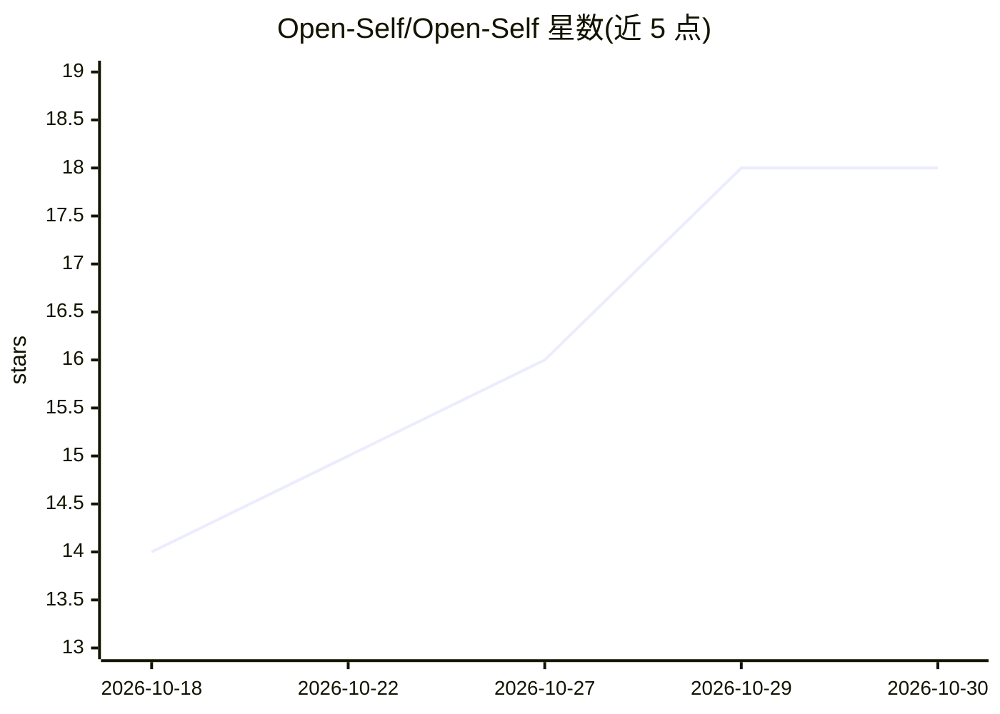

# Open-Self/Open-Self

⭐ 18 · JavaScript · MIT · 推送 2026-10-27 · [GitHub](https://github.com/Open-Self/Open-Self) · [官网](https://github.com/Open-Self/Open-Self) · 组织维护

**面向 AI agent 的用户私有个人上下文/记忆层（MCP 提供）**

本地优先的个人上下文管理系统：以 SQLite+FTS5 存储带来源、时间、作用域、敏感度与信任等级的记忆，其 Context Compiler 将任务请求编译为有界、可解释的上下文包，供 Claude、Codex、ChatGPT、Cursor 等 agent 通过 MCP、认证 dashboard 或 JavaScript API 使用。机制包括时间感知（validFrom/validTo）、supersede 生命周期、Owner 批准写入（agent 只能提议）、签名回执、哈希链审计与可移植导出。默认嵌入编码器离线确定性，Ollama/OpenAI 兼容提供商可选。需 Node.js 22.13+。

## 筛选速览

| 维度 | 判定 | 备注 |
|---|---|---|
| AI 角色 | `ai-ecosystem` | LLM/agent 周边工具 |
| 许可风险 | `permissive` | MIT |
| 部署形态 | `self-host` | docker 或自建部署 |
| 模型依赖 | local-ok | 支持本地模型 |
| 硬件要求 | — | 无带数字的原话,不猜 |
| 安装摩擦 | `low` | 无编译、无系统依赖或容器化 |
| 成熟度 | `idea` | |

## 能力要点

- Context Compiler 按策略过滤、去重、打包上下文并生成签名回执
- 记忆带来源、时间、作用域、敏感度、信任等级；agent 提议需 Owner 批准
- Ed25519 签名导出与哈希链审计（audit verify 检测篡改）
- 默认离线特征哈希嵌入，混合 FTS5+向量检索（RRF 融合）

## 适用场景

- 让多个 AI agent 共享同一份可审计的私有记忆，而不暴露全部数据
- 导入 Markdown、WhatsApp/Telegram 聊天记录建立个人上下文库
- 审查 agent 提议的记忆并控制其可访问的作用域与敏感度
- 对比不同上下文编译结果（Context Lab）后再分享给 agent

## 场景标签

`Agent 记忆` · 领域:Agent 开发

## 证据(README 行号)

> L14: OpenSelf is the user-owned **Personal Context OS** for AI agents — one private context
> L63: - **Agent-native:** MCP tools, resources, and prompts work with compatible AI clients over
> L15: layer for Claude, Codex, ChatGPT, Cursor, local agents, and whatever comes next. It stores

## 星数曲线

2026-10-18 14 → 2026-10-30 18（+4）

---
*卡片 v1 · prompt 1.4 · 生成 2026-10-29 · 置信度 high · 依据 README sha `feda0b52b1ea` · [字段定义](../../DATASET.md)*
