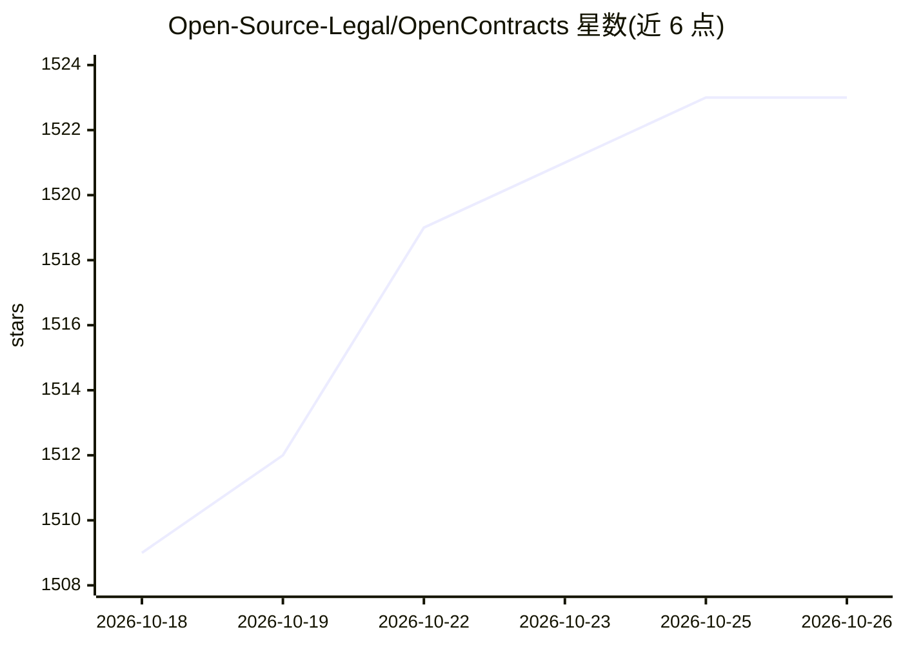

# Open-Source-Legal/OpenContracts

⭐ 1,523 · Python · MIT · 推送 2026-10-25 · [GitHub](https://github.com/Open-Source-Legal/OpenContracts) · [官网](https://open-source-legal.github.io/OpenContracts/) · 组织维护

**开源自托管文档智能平台：标注、引用图谱、AI agent 与 MCP 服务**

面向需要管理大量文档团队的文档管理系统：将文档组织为带版本控制与权限的 corpus，支持 PDF 布局保真的人工标注（PAWLS 坐标映射），自动检测并解析法律等引用形成可导航的引用图谱。同一图谱通过 GraphQL+REST API、React UI 与内置 MCP 服务器三个界面访问，可供 Claude、Cursor 等 MCP 客户端检索。另提供可配置 AI agent、基于 LLM 查询的批量结构化抽取（Celery 分发、人工逐格审批）、向量与全文检索，解析/嵌入/缩略图组件可插拔。自托管，MIT 许可，Docker 部署，自 2019 年开发。

## 筛选速览

| 维度 | 判定 | 备注 |
|---|---|---|
| AI 角色 | `ai-ecosystem` | LLM/agent 周边工具 |
| 许可风险 | `permissive` | MIT |
| 部署形态 | `self-host` | docker 或自建部署 |
| 模型依赖 | — | README 未给出锁定关系 |
| 硬件要求 | — | 无带数字的原话,不猜 |
| 安装摩擦 | `low` | 无编译、无系统依赖或容器化 |
| 成熟度 | — | 结构信号不足 |

## 能力要点

- 同一引用图谱三界面访问：GraphQL+REST API、React UI、内置 MCP 服务器（search_corpus 等工具）
- 人工标注作为 ground truth：自定义标签、多页选区、关系映射
- fieldset 自然语言查询批量结构化抽取，Celery 分发并逐格人工审批
- 自动检测并解析文档间引用，未收录的法律以 backlog 跟踪

## 适用场景

- 法律团队将 SEC 文件等文档库建为可导航的引用图谱并问答
- 通过 Claude/Cursor 等 MCP 客户端让 agent 检索和标注自己的 corpus
- 跨数百份合同批量抽取结构化字段并人工审核

## 场景标签

`文档解析` `文档问答` · 领域:知识与检索

## 证据(README 行号)

> L7: Point OpenContracts at a repository of documents and get a programmable citation graph — human annotation, structure
> L9: > Same graph, three surfaces: a **GraphQL + REST API** for your apps, a **Model Context Protocol** server for your a

## 星数曲线

2026-10-18 1,509 → 2026-10-26 1,523（+14）

---
*卡片 v1 · prompt 1.4 · 生成 2026-10-21 · 置信度 high · 依据 README sha `ecb16ebe5edd` · [字段定义](../../DATASET.md)*
