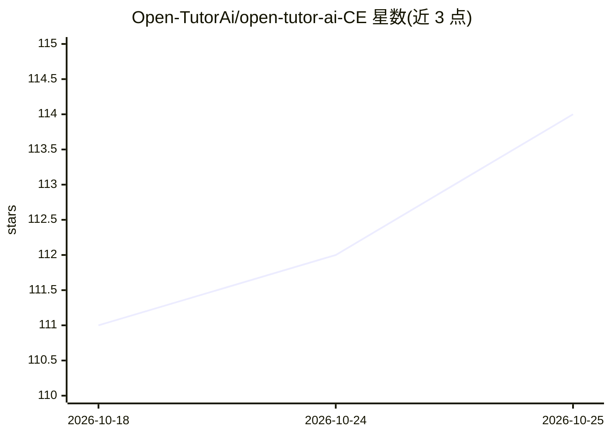

# Open-TutorAi/open-tutor-ai-CE

⭐ 114 · JavaScript · BSD-3-Clause · 推送 2026-06-26 · [GitHub](https://github.com/Open-TutorAi/open-tutor-ai-CE) · [官网](https://opentutorai.com) · 组织维护

**面向教育的开源 AI 辅导平台（社区版）**

OpenTutorAI-CE 是社区版开源项目，作为商业企业版（EE）的基础。功能包括：接入 Ollama 与 OpenAI 兼容 API（LMStudio、GroqCloud、Mistral、OpenRouter 等）、多模型并行对话、Model Builder 创建 Ollama 模型与自定义 agent、本地 RAG（教材/笔记/作业融入上下文）与网页搜索 RAG（Google PSE、SearXNG、Brave、DuckDuckGo）、个性化 LLM 与虚拟形象生成、语音/视频/形象对话模式、AUTOMATIC1111/ComfyUI/DALL-E 图像生成、RBAC 权限与人机协同治理。部署以 Docker Compose 为主（含 :ollama 与 :cuda 镜像），也可本地开发（Python 3.11–3.12 + Node.js 18.13–22.x），支持 PWA 与阿拉伯语/法语/英语多语言。首个注册账号成为管理员。

## 筛选速览

| 维度 | 判定 | 备注 |
|---|---|---|
| AI 角色 | `ai-native` | 本体是模型或模型工具 |
| 许可风险 | `permissive` | BSD-3-Clause |
| 部署形态 | `self-host` | docker 或自建部署 |
| 模型依赖 | local-ok | 支持本地模型 |
| 硬件要求 | — | 无带数字的原话,不猜 |
| 安装摩擦 | `low` | 无编译、无系统依赖或容器化 |
| 成熟度 | — | 结构信号不足 |

## 能力要点

- 接入 Ollama 与 OpenAI 兼容 API（LMStudio/GroqCloud/Mistral/OpenRouter 等）
- 本地 RAG 融入教材、笔记与作业，支持 Google PSE/SearXNG/Brave/DuckDuckGo 网页搜索
- Model Builder 创建 Ollama 模型与自定义 agent，多模型并行对话
- Docker-first 部署（含 :ollama 与 :cuda 镜像）、RBAC 与 PWA 离线模式

## 适用场景

- 搭建个性化 AI 辅导与学习平台
- 将教材、笔记、作业接入本地 RAG 做上下文教学问答
- 通过语音、视频与虚拟形象进行沉浸式学习对话

## 场景标签

`RAG` `AI 助手` `图像生成` · 领域:对话与助手

## 证据(README 行号)

> L24: **OpenTutorAI-CE** (Community Edition) is an open-source, AI-powered educational platform that makes personalized t
> L35: - **Local RAG** — integrate textbooks, notes, and assignments into context-aware tutoring sessions
> L41: - **Personalized LLM + avatar generation** — pair AI personas with individual learner profiles

## 星数曲线

2026-10-18 111 → 2026-10-25 114（+3）

---
*卡片 v1 · prompt 1.4 · 生成 2026-10-23 · 置信度 mid · 依据 README sha `2e7ee216414c` · [字段定义](../../DATASET.md)*
