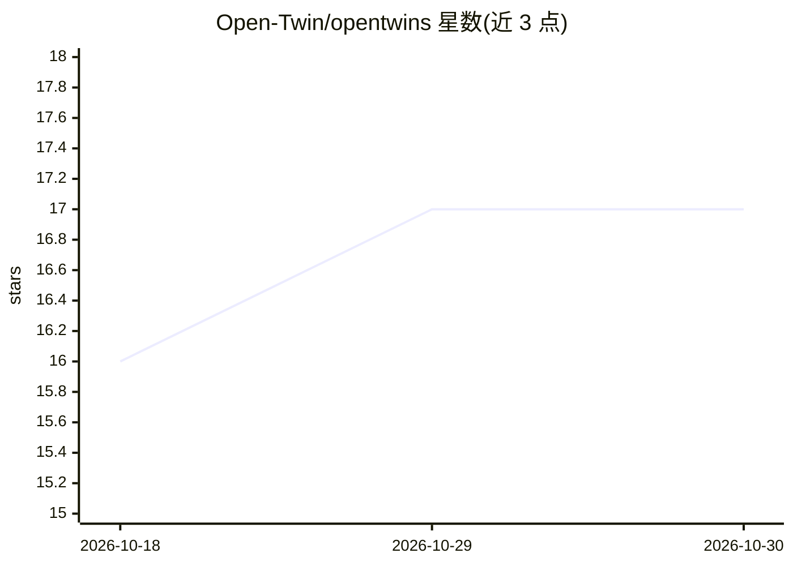

# Open-Twin/opentwins

⭐ 17 · Handlebars · MIT · 推送 2026-07-17 · [GitHub](https://github.com/Open-Twin/opentwins) · [官网](https://opentwins.ai) · 组织维护

**在 10 个社交平台部署自主 AI 数字分身的自动化工具**

基于 Node.js 的 CLI 工具，用 Claude Code 作为 AI 大脑，在 Reddit、Twitter/X、LinkedIn、Bluesky 等 10 个平台运行每小时自主交互的平台 agent（评论、发帖、互动），并每日执行 7 阶段内容管线（趋势预测、竞品监测、内容生成等）。内置 Web 仪表盘（localhost:3847）管理 agent、活动与质量指标，用 Chrome CDP 做浏览器自动化，SQLite 存储数据。需要 Node.js 18+ 与 Claude Code CLI，身份、语气、日程通过设置向导配置。

## 筛选速览

| 维度 | 判定 | 备注 |
|---|---|---|
| AI 角色 | `ai-native` | 本体是模型或模型工具 |
| 许可风险 | `permissive` | MIT |
| 部署形态 | `library` | 以包/库形式分发 |
| 模型依赖 | locked-api |  |
| 硬件要求 | — | 无带数字的原话,不猜 |
| 安装摩擦 | `low` | 无编译、无系统依赖或容器化 |
| 成熟度 | — | 结构信号不足 |

## 能力要点

- 10 个平台的自主 agent，每小时在活跃时段运行
- 7 阶段每日内容管线（趋势预测到平台化内容生成）
- Web 仪表盘含 agent 控制、活动事件流与质量趋势图表
- 支持 Claude Code 订阅 OAuth 或 Anthropic API key 两种认证

## 适用场景

- 用自己的身份和语气让 AI 分身在各社交平台互动
- 自动化内容策划与发布流水线
- 通过仪表盘监控 agent 活动与内容质量指标

## 场景标签

`浏览器自动化` `AI 写作` · 领域:效率与自动化

## 证据(README 行号)

> L10: > Deploy AI agents that engage on LinkedIn, Twitter/X, Reddit, Bluesky, Threads, Medium, Substack, Dev.to, Product 
> L101: - **Claude Code** as the AI brain (runs agents via `claude` CLI)

## 星数曲线

2026-10-18 16 → 2026-10-30 17（+1）

---
*卡片 v1 · prompt 1.4 · 生成 2026-10-30 · 置信度 high · 依据 README sha `71574eaa1e9e` · [字段定义](../../DATASET.md)*
