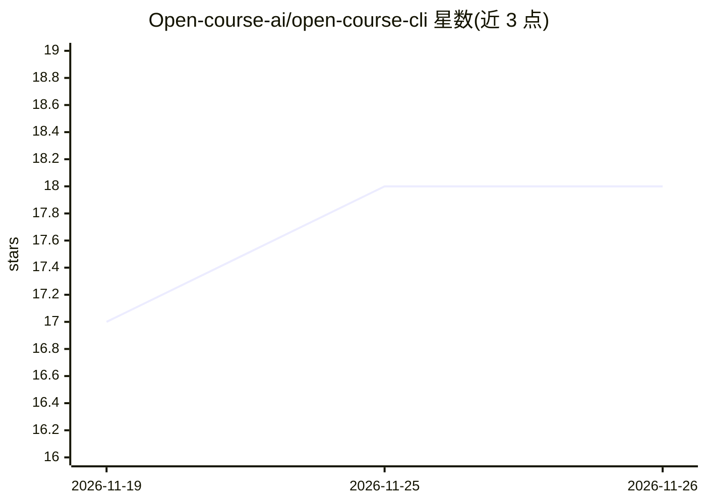

# Open-course-ai/open-course-cli

⭐ 18 · Rust · Apache-2.0 · 推送 2026-11-18 · [GitHub](https://github.com/Open-course-ai/open-course-cli) · [官网](https://open-course.eu) · 个人维护

**终端里的 AI 语言学习导师：练习与讲解由所选 LLM 生成**

用 Rust 编写的终端 TUI 应用，面向语言学习者：按母语-目标语言对组织课程，由用户选择的 LLM 生成课程、翻译练习批次并分析答案，配合间隔重复追踪薄弱主题与微型学习项。数据经 LanceDB 存储在全局目录，支持可选的云端同步（设备授权流、离线优先）。提供安装脚本与 cargo 安装两种途径，发布覆盖 macOS Apple Silicon 与 Linux x86_64；无对应二进制的平台需自行用 Rust 工具链编译运行。

## 筛选速览

| 维度 | 判定 | 备注 |
|---|---|---|
| AI 角色 | `ai-native` | 本体是模型或模型工具 |
| 许可风险 | `permissive` | Apache-2.0 |
| 部署形态 | `library` | 以包/库形式分发 |
| 模型依赖 | local-ok | 支持本地模型 |
| 硬件要求 | — | 无带数字的原话,不猜 |
| 安装摩擦 | `low` | 无编译、无系统依赖或容器化 |
| 成熟度 | — | 结构信号不足 |

## 能力要点

- 多 LLM 提供商接入：OpenAI/Anthropic/Gemini/DeepSeek/Mistral/OpenRouter/Ollama 及任意 OpenAI 兼容端点
- LLM 生成课程、翻译练习与答案分析，配合间隔重复调度
- LanceDB 本地存储 + 可选云同步（离线优先）
- 启动时自动检查并提示 GitHub Release 更新

## 适用场景

- 在终端里按 CEFR 等级练习目标语言的翻译题
- 用本地 Ollama 免 API key 生成练习
- 多设备间同步课程与学习进度

## 场景标签

`AI 助手` · 领域:对话与助手

## 证据(README 行号)

> L3: Terminal AI tutor for language learning. Exercises, lessons, and answer analysis are generated by an LLM provider yo
> L76: 3. The LLM generates a batch of translation exercises for the chosen topic.

## 星数曲线

2026-11-19 17 → 2026-11-26 18（+1）

---
*卡片 v1 · prompt 1.4 · 生成 2026-11-19 · 置信度 high · 依据 README sha `87f87547b4b2` · [字段定义](../../DATASET.md)*
