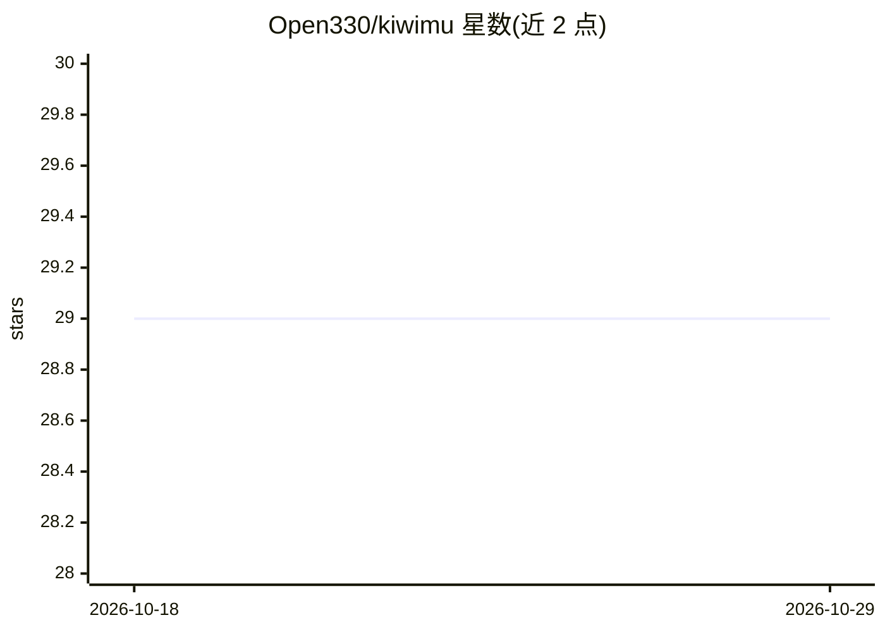

# Open330/kiwimu

⭐ 29 · TypeScript · MIT · 推送 2026-10-26 · [GitHub](https://github.com/Open330/kiwimu) · [官网](https://open330.github.io/kiwimu/) · 个人维护

**把教科书/PDF/网页变成 LLM 生成的个人学习维基**

面向个人学习者的 CLI+Web 工具：读入 URL、PDF、DOCX、PPTX、Markdown 后由 LLM 生成保留章节结构的原文页面与概念页面，自动相互链接并附内联引用，构成可浏览的知识图谱；提供拖选提问生成新页面、SM-2 间隔重复自动出题、Ask-the-Wiki RAG 问答。支持 6 个 LLM 提供商（含本地 Ollama），带 API key 免费的 demo 模式。需 Bun ≥1.3.14 运行时（不支持 Node/npx），提供 Docker Compose 与 GitHub Pages/Vercel 静态部署（静态部署不含 /api 功能）。

## 筛选速览

| 维度 | 判定 | 备注 |
|---|---|---|
| AI 角色 | `ai-native` | 本体是模型或模型工具 |
| 许可风险 | `permissive` | MIT |
| 部署形态 | `self-host` | docker 或自建部署 |
| 模型依赖 | local-ok | 支持本地模型 |
| 硬件要求 | — | 无带数字的原话,不猜 |
| 安装摩擦 | `low` | 无编译、无系统依赖或容器化 |
| 成熟度 | — | 结构信号不足 |

## 能力要点

- LLM 自动生成原文页+概念页并交叉链接，AI 生成句附内联引用
- Ask-the-Wiki：页面嵌入后的语义检索 + 全库 RAG 问答（含引用）
- Anki 风格 SM-2 间隔重复与自动出题，学习仪表盘可视化
- 6 个 LLM 提供商（Gemini/Azure OpenAI/OpenAI/Anthropic/Ollama/OpenRouter）+ 无 API key demo 模式

## 适用场景

- 把教材或讲义 PDF 转成可互相跳转的个人学习维基
- 学习中拖选不懂的段落直接提问并把答案沉淀为词条
- 用间隔重复和自动生成的测验巩固学过的概念

## 场景标签

`知识库管理` `文档问答` · 领域:知识与检索

## 证据(README 行号)

> L5: **Turn any textbook into your personal learning wiki**
> L7: 전공책, PDF, 웹 콘텐츠를 넣으면 — LLM이 자동으로 상호 링크된 학습 위키 + 퀴즈를 생성합니다.
> L77: - **6개 LLM 프로바이더** — Google Gemini, Azure OpenAI, OpenAI, Anthropic, Ollama(로컬·무료), OpenRouter

## 星数曲线

2026-10-18 29 → 2026-10-29 29（+0）

---
*卡片 v1 · prompt 1.4 · 生成 2026-10-26 · 置信度 high · 依据 README sha `9d2099231034` · [字段定义](../../DATASET.md)*
