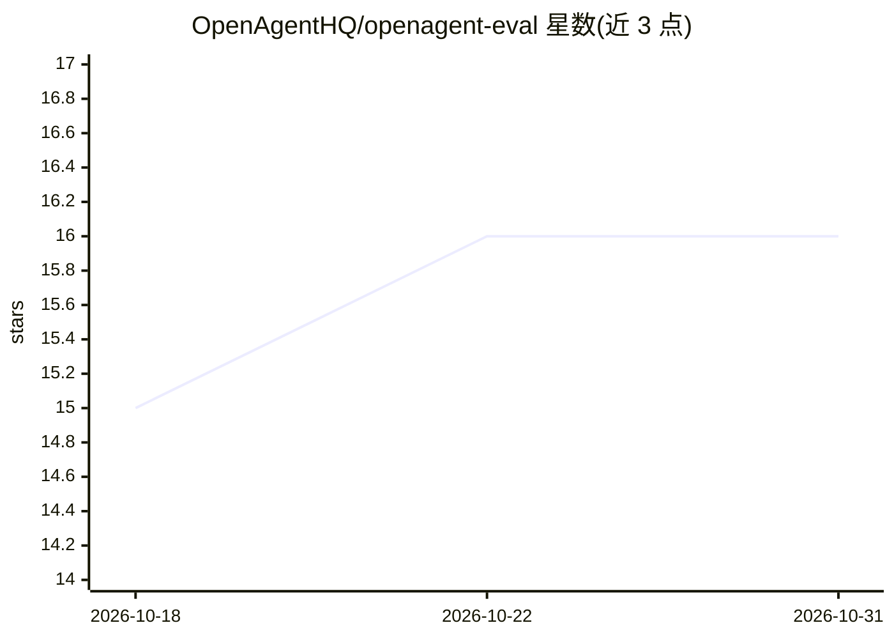

# OpenAgentHQ/openagent-eval

⭐ 16 · Python · Apache-2.0 · 推送 2026-10-27 · [GitHub](https://github.com/OpenAgentHQ/openagent-eval) · [官网](https://openagenthq.github.io/openagent-eval/) · 组织维护

**本地优先的 RAG 与 AI Agent 评测框架，CLI + SDK**

面向 RAG 系统与 AI Agent 的开源评测框架，以 pip 安装的 Python 包提供，可通过 oaeval CLI 或 SDK 使用。提供 18+ 指标，覆盖检索（Precision@K、MRR、NDCG）、生成（NLI 忠实度、幻觉检测、LLM-as-Judge）与性能成本（延迟、token、费用估算）。框架无关，兼容 LangChain/LlamaIndex 及多种 LLM 与向量库提供方；本地优先，无需云端服务，内置 mock provider 可离线运行完整流程。另含语料健康审计、失败归因诊断与合成测试数据生成。

## 筛选速览

| 维度 | 判定 | 备注 |
|---|---|---|
| AI 角色 | `ai-ecosystem` | LLM/agent 周边工具 |
| 许可风险 | `permissive` | Apache-2.0 |
| 部署形态 | `library` | 以包/库形式分发 |
| 模型依赖 | — | README 未给出锁定关系 |
| 硬件要求 | — | 无带数字的原话,不猜 |
| 安装摩擦 | `low` | 无编译、无系统依赖或容器化 |
| 成熟度 | — | 结构信号不足 |

## 能力要点

- 18+ 评测指标：检索、生成（NLI 忠实度/幻觉检测/LLM-as-Judge）、性能与成本
- 本地优先，内置 mock provider 无需 API key 即可离线跑通全流程
- 语料健康审计、失败归因（检索/生成/分块）与合成测试数据生成
- 插件化扩展：自定义指标、提供方与报告生成器

## 适用场景

- 为我的 RAG 问答系统做检索与忠实度评测
- 在本地离线验证评测流程后再接入真实模型
- 诊断评测失败应归因于检索还是生成环节
- 从自有知识库自动生成测试用例

## 场景标签

`模型评测` · 领域:评测与运维

## 证据(README 行号)

> L3: **The open-source evaluation framework for RAG systems and AI Agents.**
> L22: Evaluating RAG systems shouldn't require a PhD or a cloud account. OpenAgent Eval brings **pytest-level simplicity*
> L26: - **18+ metrics** — Retrieval, generation, faithfulness, relevancy, performance, and cost

## 星数曲线

2026-10-18 15 → 2026-10-31 16（+1）

---
*卡片 v1 · prompt 1.4 · 生成 2026-10-30 · 置信度 high · 依据 README sha `2380d3279087` · [字段定义](../../DATASET.md)*
