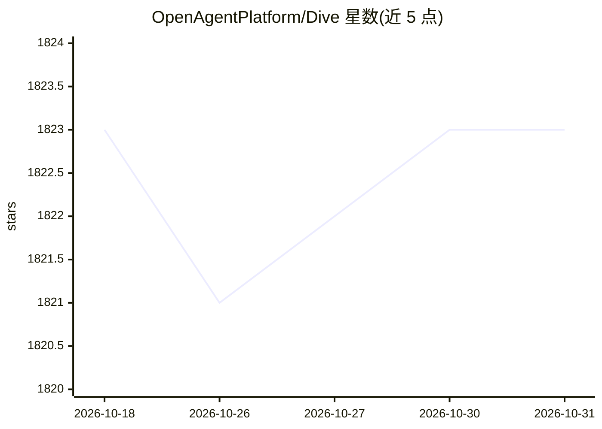

# OpenAgentPlatform/Dive

⭐ 1,823 · TypeScript · MIT · 推送 2026-07-31 · [GitHub](https://github.com/OpenAgentPlatform/Dive) · 组织维护 · 中文 README

**桌面端 MCP Host 应用：通过 MCP 工具与任意函数调用 LLM 对话**

跨平台（Windows/macOS/Linux）的开源 MCP Host 桌面应用，支持 ChatGPT、Anthropic、Ollama 及 OpenAI 兼容模型，以 stdio/SSE 两种模式接入 MCP 服务器，内置 Fetch、文件管理、Bash 等本地工具。提供 Electron 与 Tauri 双架构版本，支持 24+ 界面语言、多 API key 与模型切换、单个 MCP 工具粒度启停、聊天历史搜索与技能/斜杠命令。macOS/Linux 需自行安装 Python 与 Node.js 环境；Windows 版启动后自动下载。

## 筛选速览

| 维度 | 判定 | 备注 |
|---|---|---|
| AI 角色 | `ai-native` | 本体是模型或模型工具 |
| 许可风险 | `permissive` | MIT |
| 部署形态 | `desktop` | 安装包/桌面程序 |
| 模型依赖 | local-ok | 支持本地模型 |
| 硬件要求 | — | 无带数字的原话,不猜 |
| 安装摩擦 | `low` | 无编译、无系统依赖或容器化 |
| 成熟度 | — | 结构信号不足 |

## 能力要点

- stdio 与 SSE 模式接入 MCP 服务器，支持服务器认证
- 内置 Fetch/文件管理/Bash 本地工具与 MCP 服务器安装 Agent
- Electron 与 Tauri 双架构，Windows/macOS/Linux 三平台安装包
- 多 API key、模型切换与单个 MCP 工具启停控制

## 适用场景

- 在桌面端统一管理与多个 LLM 和 MCP 工具的对话
- 通过 OAPHub.ai 一键接入托管 MCP 服务器，免本地部署
- 自定义系统提示词与工具组合搭建个人 AI Agent 工作台

## 场景标签

`AI 助手` `聊天机器人` · 领域:对话与助手

## 证据(README 行号)

> L14: Dive is an open-source MCP Host Desktop Application that seamlessly integrates with any LLMs supporting function ca
> L20: - 🌐 **Universal LLM Support**: Compatible with ChatGPT, Anthropic, Ollama and OpenAI-compatible models
> L22: - 🔄 **Model Context Protocol**: Enabling seamless MCP AI agent integration on both stdio and SSE mode

## 星数曲线

2026-10-18 1,823 → 2026-10-31 1,823（+0）

---
*卡片 v1 · prompt 1.4 · 生成 2026-10-21 · 置信度 mid · 依据 README sha `35264c62759b` · [字段定义](../../DATASET.md)*
