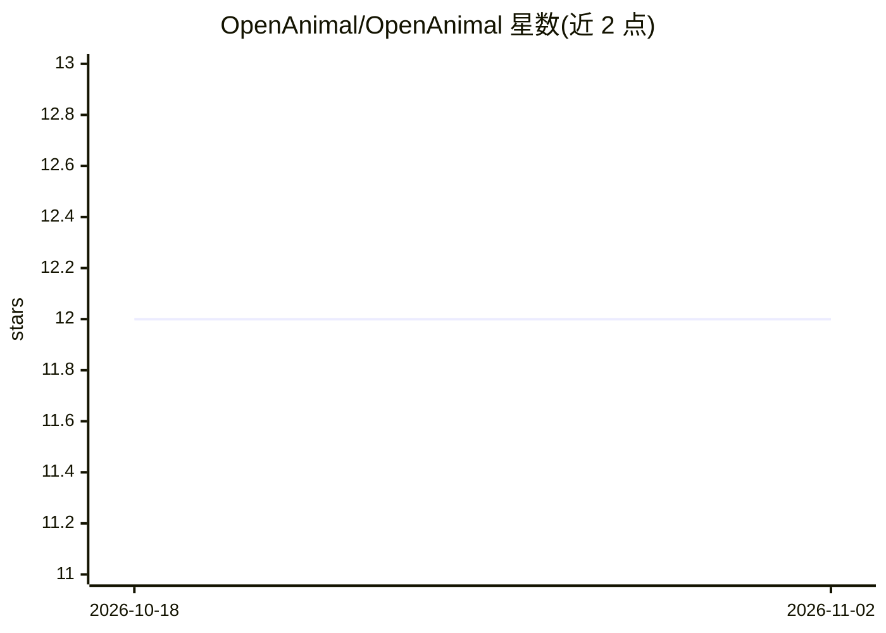

# OpenAnimal/OpenAnimal

⭐ 12 · C++ · NOASSERTION · 推送 2026-08-15 · [GitHub](https://github.com/OpenAnimal/OpenAnimal) · 个人维护

**虚幻引擎动物行为模拟框架，带神经网络感知与情感建模**

基于 Unreal Engine 的动物及类人行为建模与仿真框架，集成 ONNX 神经网络推理（Blueprint 原生）、语音转文本与说话人识别、动物姿态/面部/注视检测、行为与情绪状态建模（早期阶段）。核心模块 OpenBrain 为 Actor 与物理平台提供自主行为能力，可完全离线运行于手机与低成本硬件。支持 Windows/Android 平台，提供 LLM/VLM 可选接入（Ollama）。作者声明项目处于早期阶段且本人难以继续维护。

## 筛选速览

| 维度 | 判定 | 备注 |
|---|---|---|
| AI 角色 | `ai-native` | 本体是模型或模型工具 |
| 许可风险 | `none` | NOASSERTION |
| 部署形态 | `None` |  |
| 模型依赖 | local-ok | 支持本地模型 |
| 硬件要求 | — | 无带数字的原话,不猜 |
| 安装摩擦 | `low` | 无编译、无系统依赖或容器化 |
| 成熟度 | `idea` | |

## 能力要点

- Unreal Engine 内原生 ONNX 推理（Blueprint 中调用）
- 语音转文本、说话人识别与动物姿态/面部/注视检测
- 行为与情绪状态建模（preliminary）
- 支持 Android 与 Arduino 硬件集成，可完全离线运行

## 适用场景

- 制作自主行为的虚拟宠物与机器人
- 机器人与硬件原型开发
- 社会行为研究的仿真实验
- 教学演示用途

## 场景标签

`Agent 框架` · 领域:Agent 开发

## 证据(README 行号)

> L13: OpenAnimal is an extensible Unreal Engine–based framework for modeling and simulating animal- and human-like behavi
> L15: OpenBrain is a self-contained, plug-and-play Animal Brain system designed to bring autonomous behavior to any Actor

## 星数曲线

2026-10-18 12 → 2026-11-02 12（+0）

---
*卡片 v1 · prompt 1.4 · 生成 2026-11-01 · 置信度 high · 依据 README sha `5ea31f0fa48e` · [字段定义](../../DATASET.md)*
