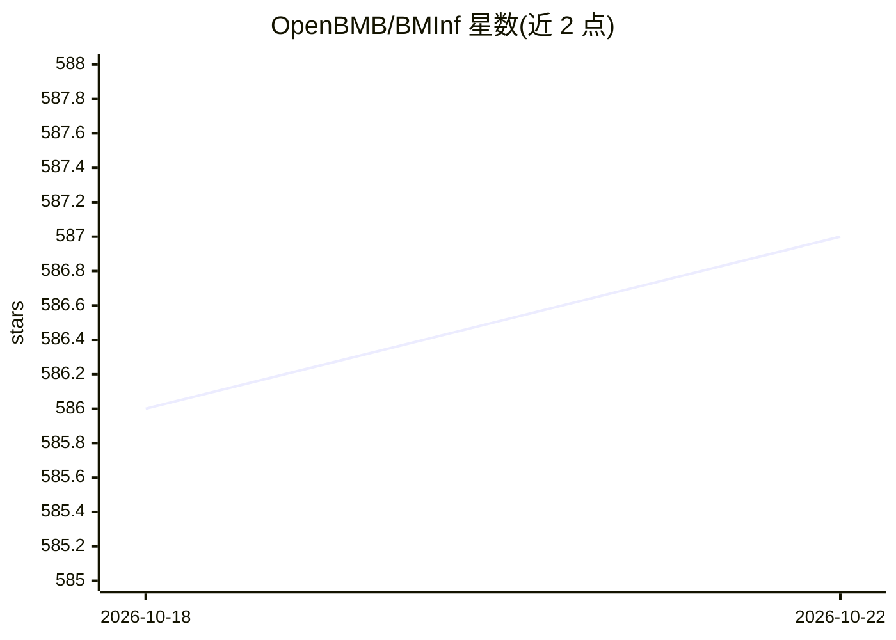

# OpenBMB/BMInf

⭐ 587 · Python · Apache-2.0 · 推送 2026-07-07 · [GitHub](https://github.com/OpenBMB/BMInf) · 组织维护 · 中文 README

**大规模预训练语言模型的低资源推理优化库**

面向大规模预训练语言模型（PLM）的低资源推理 Python 包，由 OpenBMB 团队维护。支持在单张 NVIDIA GTX 1060 GPU 上运行百亿参数以上模型；在显存充足的 GPU（如 V100/A100）上，相对现有 PyTorch 实现提升推理速度。核心机制是 bminf.wrapper 自动转换模型，或手动替换 nn.ModuleList 为 TransformerBlockList、nn.Linear 为 QuantizedLinear（量化线性层）。要求 CUDA>=10.1、Python>=3.6、torch>=1.7.1。以论文 BMInf (ACL 2022) 为依据发布。

## 筛选速览

| 维度 | 判定 | 备注 |
|---|---|---|
| AI 角色 | `ai-ecosystem` | LLM/agent 周边工具 |
| 许可风险 | `permissive` | Apache-2.0 |
| 部署形态 | `library` | 以包/库形式分发 |
| 模型依赖 | — | README 未给出锁定关系 |
| 硬件要求 | — | 无带数字的原话,不猜 |
| 安装摩擦 | `medium` | 含编译或系统依赖之一 |
| 成熟度 | — | 结构信号不足 |

## 能力要点

- 单张 GTX 1060（6GB）运行 100 亿参数以上模型
- bminf.wrapper 一行代码自动转换模型
- QuantizedLinear 量化线性层与 TransformerBlockList 手动替换接口
- 支持计算能力 6.1 以上的 NVIDIA GPU

## 适用场景

- 在消费级 GPU 上运行百亿参数级语言模型推理
- 对现有 PyTorch Transformer 模型做推理加速
- 量化部署大模型以降低显存占用

## 场景标签

`模型量化` `推理引擎` · 领域:训练与推理

## 证据(README 行号)

> L21: BMInf (Big Model Inference) is a low-resource inference package for large-scale pretrained language models (PLMs).
> L23: BMInf supports running models with more than 10 billion parameters on a single NVIDIA GTX 1060 GPU in its minimum r

## 星数曲线

2026-10-18 586 → 2026-10-22 587（+1）

---
*卡片 v1 · prompt 1.4 · 生成 2026-10-21 · 置信度 high · 依据 README sha `fafb7207973f` · [字段定义](../../DATASET.md)*
