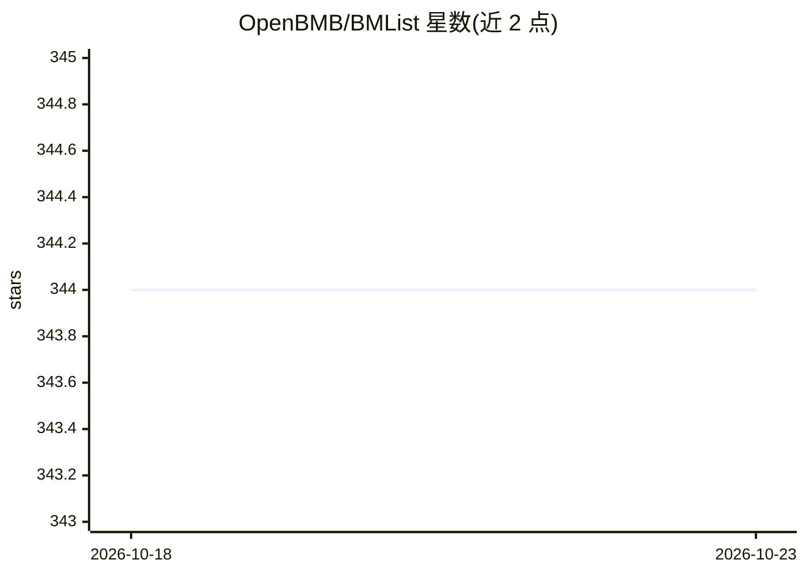

# OpenBMB/BMList

⭐ 344 · Python · Apache-2.0 · 推送 2026-07-07 · [GitHub](https://github.com/OpenBMB/BMList) · 组织维护 · 中文 README

**十亿参数以上大模型清单：收录公开发布的模型及统计图表**

OpenBMB 维护的大模型聚合清单：收录参数量达 10 亿以上、且通过论文/文章/新闻公开发布的模型，以多维表格展示机构、语言、领域等维度信息；另维护网站发布模型趋势、按机构统计模型数量与参数量、按时间统计模型数量与参数量等五类图表。社区可通过 issue 和 pull request 补充条目，新增模型后表格与网站自动更新。定位为展示大模型发展动态的知识清单，不含可直接运行的软件。

## 筛选速览

| 维度 | 判定 | 备注 |
|---|---|---|
| AI 角色 | `ai-knowledge` | 知识聚合/清单类 |
| 许可风险 | `permissive` | Apache-2.0 |
| 部署形态 | `None` |  |
| 模型依赖 | — | README 未给出锁定关系 |
| 硬件要求 | — | 无带数字的原话,不猜 |
| 安装摩擦 | `low` | 无编译、无系统依赖或容器化 |
| 成熟度 | — | 结构信号不足 |

## 能力要点

- 收录标准明确：参数量 ≥1B 且已公开发布
- 多维表格支持按机构、语言、领域等维度分类
- 配套网站提供 5 类模型统计图表
- 社区贡献后表格与网站自动更新

## 适用场景

- 查找已公开发布的十亿参数以上大模型
- 按机构和时间维度了解大模型发展动态
- 作为大模型研究的选型参考清单

## 场景标签

`精选清单` · 领域:学习与行业

## 证据(README 行号)

> L7: Welcome to BMList! We wish to use this list to show the recent trend of big models.
> L11: 1. Have at least 1 billion parameters;

## 星数曲线

2026-10-18 344 → 2026-10-23 344（+0）

---
*卡片 v1 · prompt 1.4 · 生成 2026-10-21 · 置信度 high · 依据 README sha `954f95a18aef` · [字段定义](../../DATASET.md)*
