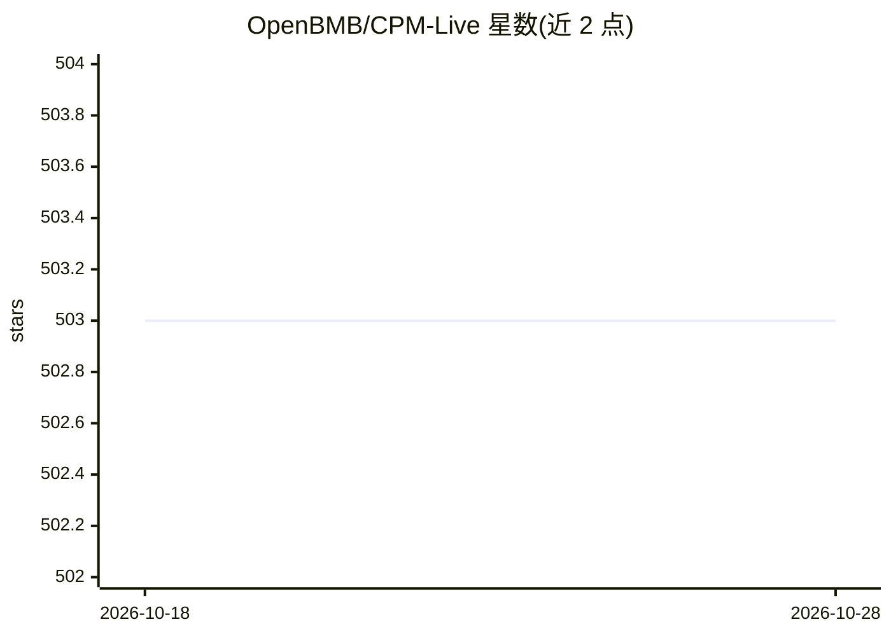

# OpenBMB/CPM-Live

⭐ 503 · Python · 推送 2026-07-07 · [GitHub](https://github.com/OpenBMB/CPM-Live) · 组织维护 · 中文 README

**开源大模型直播训练社区项目：实时展示并发布训练中的模型**

OpenBMB 发起的开源大模型实时训练项目：从 10B 规模模型开始，训练期间实时展示训练指标、每日发布训练日志、不定期发布可下载的 checkpoint，社区可提交模型架构/训练方法/数据源提案，训练完成后模型参数以含商业化许可的开放协议发布。已完成的里程碑包括 CPM-Bee、CPM-Ant+ 与 CPM-Ant。面向关注大模型训练过程与二次开发的研究者和开发者。

## 筛选速览

| 维度 | 判定 | 备注 |
|---|---|---|
| AI 角色 | `ai-ecosystem` | LLM/agent 周边工具 |
| 许可风险 | `none` | — |
| 部署形态 | `None` |  |
| 模型依赖 | — | README 未给出锁定关系 |
| 硬件要求 | — | 无带数字的原话,不猜 |
| 安装摩擦 | `low` | 无编译、无系统依赖或容器化 |
| 成熟度 | — | 结构信号不足 |

## 能力要点

- 训练期间实时展示指标、每日发布训练日志
- 不定期发布可下载的 checkpoint
- 社区可提交模型提案，采纳后加入训练
- 训练完成后以含商业化许可的开放协议发布模型参数

## 适用场景

- 跟踪开源大模型的训练过程与指标
- 下载训练中的 checkpoint 用于研究或推理
- 向社区提交模型架构或训练方法的提案

## 场景标签

`模型训练` · 领域:训练与推理

## 证据(README 行号)

> L3: **Live Training for Open-source Big Models**
> L16: Considering the scale of data and computing resources, CPM-Live will start with a 10B model training.
> L33: - **Download the resource**: Once the model training is complete, you are free to download the model parameters und

## 星数曲线

2026-10-18 503 → 2026-10-28 503（+0）

---
*卡片 v1 · prompt 1.4 · 生成 2026-10-21 · 置信度 high · 依据 README sha `55b72ff1b770` · [字段定义](../../DATASET.md)*
