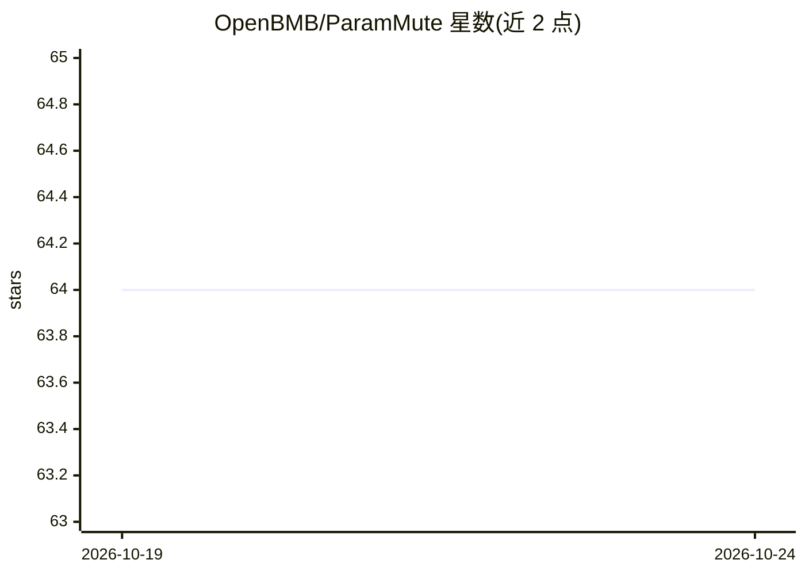

# OpenBMB/ParamMute

⭐ 64 · Python · 推送 2026-10-18 · [GitHub](https://github.com/OpenBMB/ParamMute) · [官网](https://passionate11.github.io/ParamMute-project-page/) · 组织维护 · 中文 README

**抑制关键FFN提升RAG忠实性的训练方法与模型（NeurIPS 2025）**

NeurIPS 2025 研究工作（曾用名 PIP-KAG）：定位模型忽略检索证据时过度激活的中深层（相对深度70%-90%）FFN 层，通过在训练中抑制这些 UA-FFN 的激活并做知识增强适配（SFT 或 input_contrastive 偏好优化），提升检索增强生成的上下文忠实性。提供基于修改版 transformers 的训练/评测脚本，并在 Hugging Face 发布 LLaMA3-8B-Instruct 基础上的 ParamMute-8B-SFT/KTO 模型及 CoFaithfulQA 评测集。面向 LLM 研究者，需自行下载数据并配置 Python 3.10 环境。

## 筛选速览

| 维度 | 判定 | 备注 |
|---|---|---|
| AI 角色 | `ai-native` | 本体是模型或模型工具 |
| 许可风险 | `none` | — |
| 部署形态 | `library` | 以包/库形式分发 |
| 模型依赖 | — | README 未给出锁定关系 |
| 硬件要求 | — | 无带数字的原话,不猜 |
| 安装摩擦 | `low` | 无编译、无系统依赖或容器化 |
| 成熟度 | — | 结构信号不足 |

## 能力要点

- 识别忠实/不忠实响应间激活差异最大的 Top-K FFN 层作为 UA-FFNs
- 训练时抑制 UA-FFN 激活，支持 SFT 与 input_contrastive 两种模式
- 推理时可动态调整抑制系数控制对参数化知识的依赖
- 发布 ParamMute-8B-SFT/KTO 模型与 CoFaithfulQA 评测集

## 适用场景

- 研究者复现 NeurIPS 2025 忠实性实验
- 训练减少知识冲突、更忠实于检索证据的 RAG 模型
- 用 CoFaithfulQA 评测 LLM 的上下文忠实性

## 场景标签

`RAG` `模型评测` `微调` · 领域:评测与运维

## 证据(README 行号)

> L51: **ParamMute** (NeurIPS 2025) makes retrieval-augmented LLMs more faithful to retrieved evidence by suppressing the 
> L55: We investigate the internal mechanisms behind unfaithful generation and identify a subset of **mid-to-deep (70%–90%

## 星数曲线

2026-10-19 64 → 2026-10-24 64（+0）

---
*卡片 v1 · prompt 1.4 · 生成 2026-10-24 · 置信度 high · 依据 README sha `ae4c4ba452a7` · [字段定义](../../DATASET.md)*
