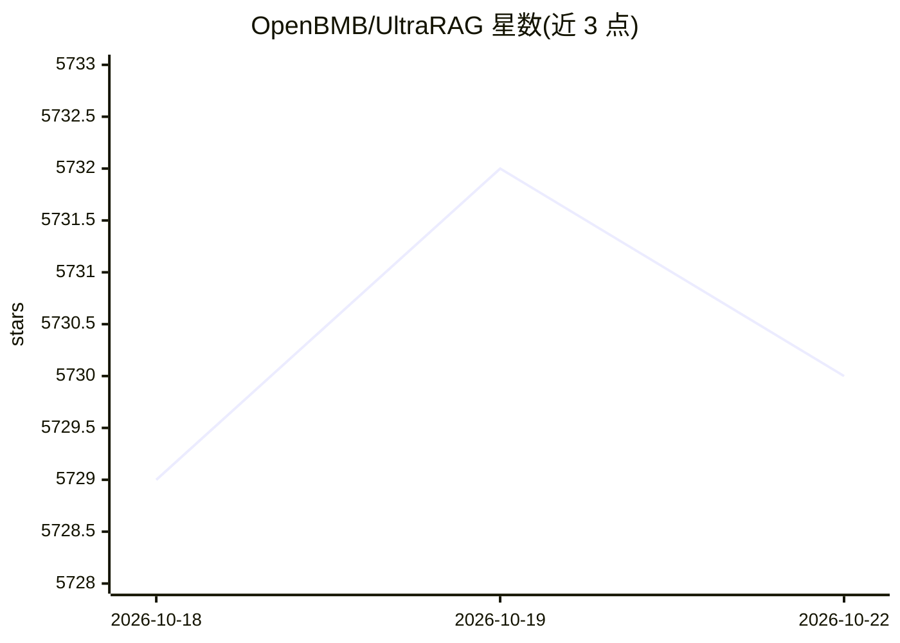

# OpenBMB/UltraRAG

⭐ 5,731 · Python · Apache-2.0 · 推送 2026-10-22 · [GitHub](https://github.com/OpenBMB/UltraRAG) · [官网](https://ultrarag.github.io/) · 组织维护 · 中文 README

**低代码 MCP 架构的 RAG 开发框架：YAML 编排复杂检索问答流水线**

由清华 THUNLP、东北大学 NEUIR、OpenBMB 等联合发布的 RAG 开发框架，面向科研探索与工业原型。基于 Model Context Protocol 将检索、生成等核心组件标准化为独立 MCP Server，通过 YAML 配置实现顺序、循环、条件分支等控制结构的编排，几十行代码即可构建复杂 RAG 流水线。提供可视化 UI（画布与代码双向同步的 Pipeline Builder、知识库管理、一键生成对话 Web UI）、统一评测工作流与主流基准集成。支持 uv 源码安装与 Docker 部署，GPU 依赖锁定 CUDA 12.9。

## 筛选速览

| 维度 | 判定 | 备注 |
|---|---|---|
| AI 角色 | `ai-ecosystem` | LLM/agent 周边工具 |
| 许可风险 | `permissive` | Apache-2.0 |
| 部署形态 | `self-host` | docker 或自建部署 |
| 模型依赖 | local-ok | 支持本地模型 |
| 硬件要求 | — | 无带数字的原话,不猜 |
| 安装摩擦 | `low` | 无编译、无系统依赖或容器化 |
| 成熟度 | — | 结构信号不足 |

## 能力要点

- MCP Server/Client 架构，YAML 配置实现循环、条件分支等复杂编排
- 可视化 UltraRAG UI：画布/代码双向同步、知识库管理、一键生成对话 Web UI
- 内置标准化评测工作流与主流 RAG 基准集成
- 一键将 Pipeline 转换为交互式对话系统

## 适用场景

- 研究人员快速搭建和复现可对比的 RAG 实验
- 工业原型中低代码构建带条件分支与循环的检索问答流水线
- 结合 AgentCPM-Report 模型部署自动多步检索生成调研报告的 Deep Research 系统

## 场景标签

`RAG` `科研工具` · 领域:知识与检索

## 证据(README 行号)

> L30: UltraRAG is the first lightweight RAG development framework based on the Model Context Protocol (MCP) architecture 
> L32: Designed for research exploration and industrial prototyping, UltraRAG standardizes core RAG components (Retriever,

## 星数曲线

2026-10-18 5,729 → 2026-10-22 5,730（+1）

---
*卡片 v1 · prompt 1.4 · 生成 2026-10-20 · 置信度 mid · 依据 README sha `243130ae6eb2` · [字段定义](../../DATASET.md)*
