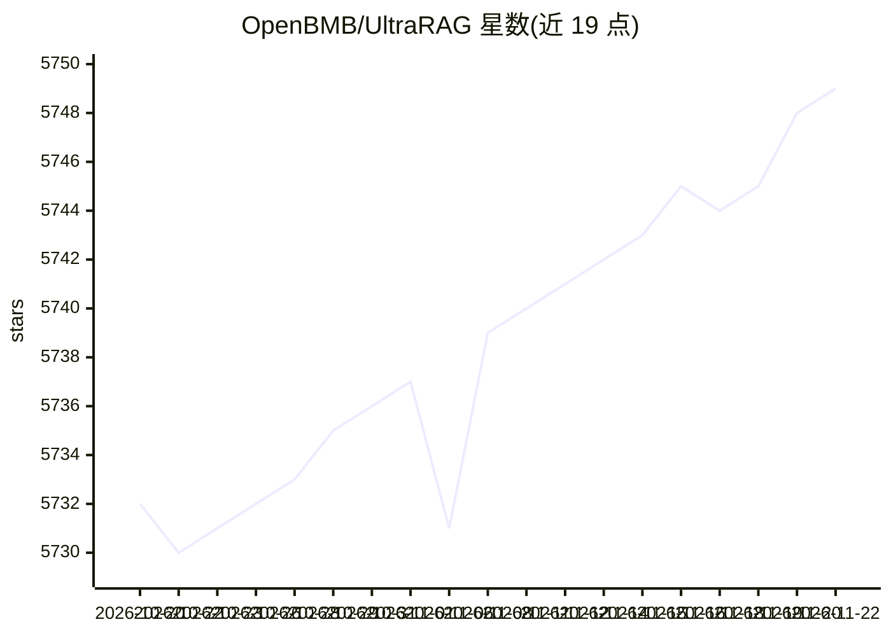

# OpenBMB/UltraRAG

⭐ 5,749 · Python · Apache-2.0 · 推送 2026-11-21 · [GitHub](https://github.com/OpenBMB/UltraRAG) · [官网](https://ultrarag.github.io/) · 组织维护 · 中文 README

**低代码 MCP 框架，帮助开发者编排复杂 RAG 流水线**

基于 MCP 架构的 RAG 开发框架，由清华 THUNLP、东北大学 NEUIR、OpenBMB 与 AI9stars 联合推出。将 Retriever、Generation 等核心组件封装为独立 MCP Server，通过 YAML 配置实现条件分支、循环等控制结构的编排；提供可视化 UltraRAG UI（画布与代码双向同步、内置 AI 助手、知识库管理）、统一评测流程与基准数据、一键将 Pipeline 转为对话式 Web UI。支持源码（uv 管理）与 Docker 部署，含 CPU/GPU 镜像。

## 筛选速览

| 维度 | 判定 | 备注 |
|---|---|---|
| AI 角色 | `ai-ecosystem` | LLM/agent 周边工具 |
| 许可风险 | `permissive` | Apache-2.0 |
| 部署形态 | `self-host` | docker 或自建部署 |
| 模型依赖 | local-ok | 支持本地模型 |
| 硬件要求 | — | 无带数字的原话,不猜 |
| 安装摩擦 | `low` | 无编译、无系统依赖或容器化 |
| 成熟度 | — | 结构信号不足 |

## 能力要点

- 核心 RAG 组件标准化为独立 MCP Server，YAML 编排条件分支与循环
- UltraRAG UI 提供画布/代码双向同步的流水线构建与调试
- 内置标准化评测工作流与主流研究基准
- 支持本地执行（--no-mcp）与 MCP 两种运行模式

## 适用场景

- 科研中快速搭建并复现 RAG 实验流程
- 构建知识库文档问答与 Deep Research 报告生成系统
- 将流水线一键转为对话式 Web UI 用于演示
- 通过可视化界面调试中间输出与错误归因

## 场景标签

`RAG` `文档问答` `模型评测` `科研工具` · 领域:评测与运维

## 证据(README 行号)

> L30: UltraRAG is the first lightweight RAG development framework based on the Model Context Protocol (MCP) architecture 
> L32: Designed for research exploration and industrial prototyping, UltraRAG standardizes core RAG components (Retriever,

## 星数曲线

2026-10-20 5,732 → 2026-11-22 5,749（+17）

---
*卡片 v1 · prompt 1.4 · 生成 2026-11-22 · 置信度 mid · 依据 README sha `df0620aabd4b` · [字段定义](../../DATASET.md)*
