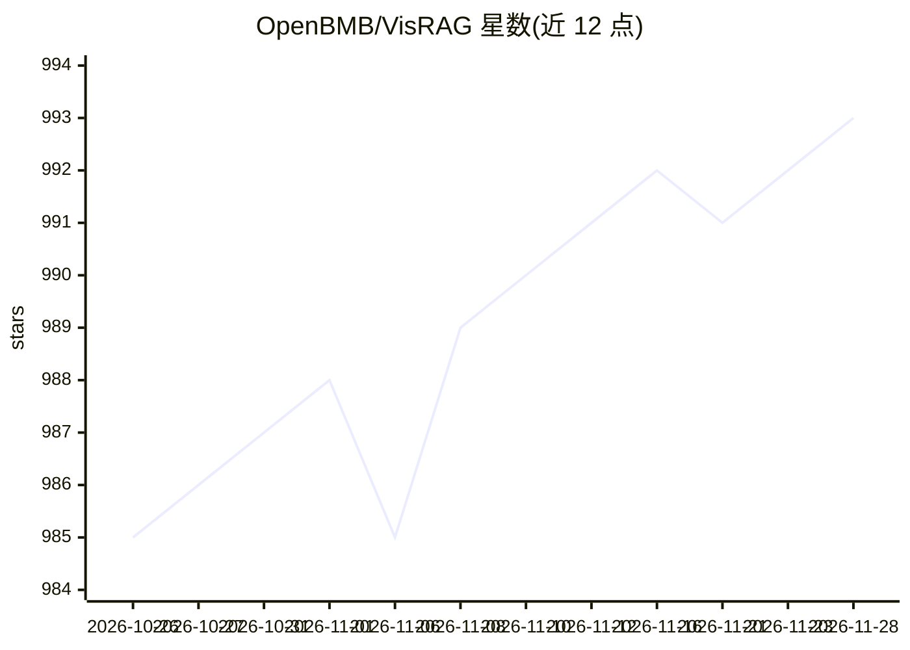

# OpenBMB/VisRAG

⭐ 993 · Python · Apache-2.0 · 推送 2026-11-02 · [GitHub](https://github.com/OpenBMB/VisRAG) · 组织维护 · 中文 README

**研究团队的免解析视觉文档 RAG 框架与模型**

VisRAG 提供基于 VLM 的免解析 RAG 流水线：文档不经文本解析、直接以图像形式由 VLM 嵌入检索，再增强 VLM 生成回答，避免解析环节的信息丢失。2.0 版 EVisRAG 加入证据引导的多图推理机制，使用 RS-GRPO 两阶段训练（SFT 基于 LLaMA-Factory，强化阶段基于 Easy-R1）并发布 3B/7B 权重。附训练脚本、评测脚本（EM/Accuracy/F1）、基准数据集与 Colab 演示；模型权重遵循 MiniCPM 许可，注册问卷后可商用。

## 筛选速览

| 维度 | 判定 | 备注 |
|---|---|---|
| AI 角色 | `ai-native` | 本体是模型或模型工具 |
| 许可风险 | `permissive` | Apache-2.0 |
| 部署形态 | `library` | 以包/库形式分发 |
| 模型依赖 | local-ok | 支持本地模型 |
| 硬件要求 | — | 无带数字的原话,不猜 |
| 安装摩擦 | `low` | 无编译、无系统依赖或容器化 |
| 成熟度 | — | 结构信号不足 |

## 能力要点

- 文档免解析、以图像直接嵌入检索的 VisRAG 流水线（Ret 基于 MiniCPM-V，Gen 可接任意 VLM）
- EVisRAG 证据引导多图推理，RS-GRPO 两阶段训练并发布 3B/7B 权重
- 提供 36 万 Query-Document 训练对、多基准评测脚本与 Colab 演示

## 适用场景

- 对 PDF/图表类文档直接做视觉检索问答
- 复现论文中的检索与生成评测结果
- 基于自己的数据训练文档嵌入模型

## 场景标签

`RAG` `模型评测` `文档问答` · 领域:评测与运维

## 证据(README 行号)

> L29: **VisRAG** is a novel vision-language model (VLM)-based RAG pipeline. In this pipeline, instead of first parsing th
> L27: **EVisRAG (VisRAG 2.0)** is an evidence-guided Vision Retrieval-augmented Generation framework that equips VLMs for

## 星数曲线

2026-10-26 985 → 2026-11-28 993（+8）

---
*卡片 v1 · prompt 1.4 · 生成 2026-11-24 · 置信度 high · 依据 README sha `072e6fc0df02` · [字段定义](../../DATASET.md)*
