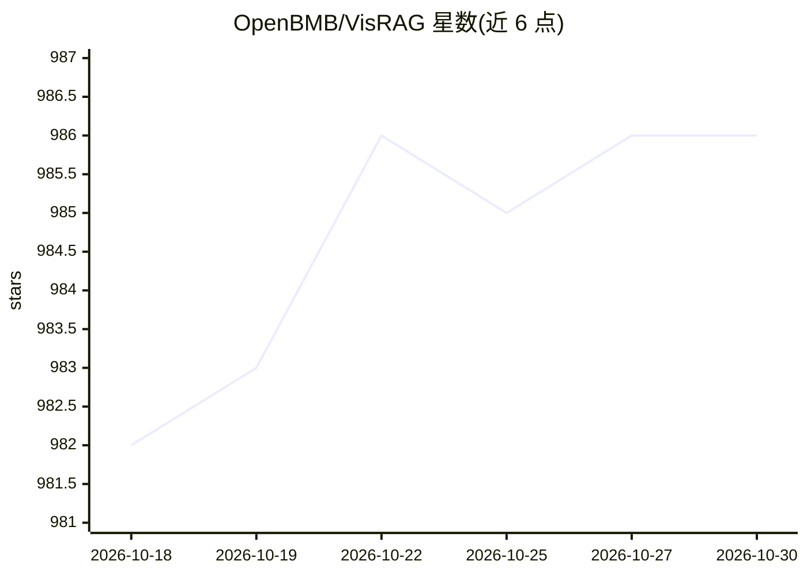

# OpenBMB/VisRAG

⭐ 986 · Python · Apache-2.0 · 推送 2026-08-09 · [GitHub](https://github.com/OpenBMB/VisRAG) · 组织维护 · 中文 README

**免解析的视觉 RAG：VLM 直接嵌入文档图像做检索与生成**

面向多模态文档问答的研究框架：跳过文档解析，将文档页面作为图像用视觉语言模型（MiniCPM-V 2.0 基座）直接嵌入检索（VisRAG-Ret），再用 VLM 生成回答（VisRAG-Gen，可用任意 VLM 如 MiniCPM-V、GPT-4o）。2.0 版 EVisRAG 面向多图像问答，通过语言化观察检索图像收集逐图证据后推理，采用 RS-GRPO 两阶段训练（SFT + 强化学习）。提供训练脚本、评测基准（EM/Accuracy/F1）与 Colab 演示；模型与数据发布于 Hugging Face。限制：VisRAG-Ret 权重需遵循 MiniCPM 模型许可。

## 筛选速览

| 维度 | 判定 | 备注 |
|---|---|---|
| AI 角色 | `ai-native` | 本体是模型或模型工具 |
| 许可风险 | `permissive` | Apache-2.0 |
| 部署形态 | `library` | 以包/库形式分发 |
| 模型依赖 | local-ok | 支持本地模型 |
| 硬件要求 | — | 无带数字的原话,不猜 |
| 安装摩擦 | `low` | 无编译、无系统依赖或容器化 |
| 成熟度 | — | 结构信号不足 |

## 能力要点

- 文档以图像形式直接嵌入检索，不经过文本解析
- EVisRAG 逐图收集证据后做多图像推理，基于 Qwen2.5-VL-7B/3B 训练
- RS-GRPO 细粒度 token 级奖励联合优化视觉感知与推理
- 362,110 Query-Document 训练对与多个评测基准公开于 Hugging Face

## 适用场景

- 我对 PDF/图表/幻灯片等文档做问答，不想经历有损的文本解析
- 我需要多图像场景下的证据引导推理问答
- 我想复现论文中的视觉检索与生成评测结果

## 场景标签

`RAG` `文档问答` `多模态` `科研工具` · 领域:知识与检索

## 证据(README 行号)

> L27: **EVisRAG (VisRAG 2.0)** is an evidence-guided Vision Retrieval-augmented Generation framework that equips VLMs for
> L29: **VisRAG** is a novel vision-language model (VLM)-based RAG pipeline. In this pipeline, instead of first parsing th
> L52: **VisRAG-Ret** is a document embedding model built on MiniCPM-V 2.0, a vision-language model that integrates SigLIP

## 星数曲线

2026-10-18 982 → 2026-10-30 986（+4）

---
*卡片 v1 · prompt 1.4 · 生成 2026-10-21 · 置信度 mid · 依据 README sha `ca983d829908` · [字段定义](../../DATASET.md)*
