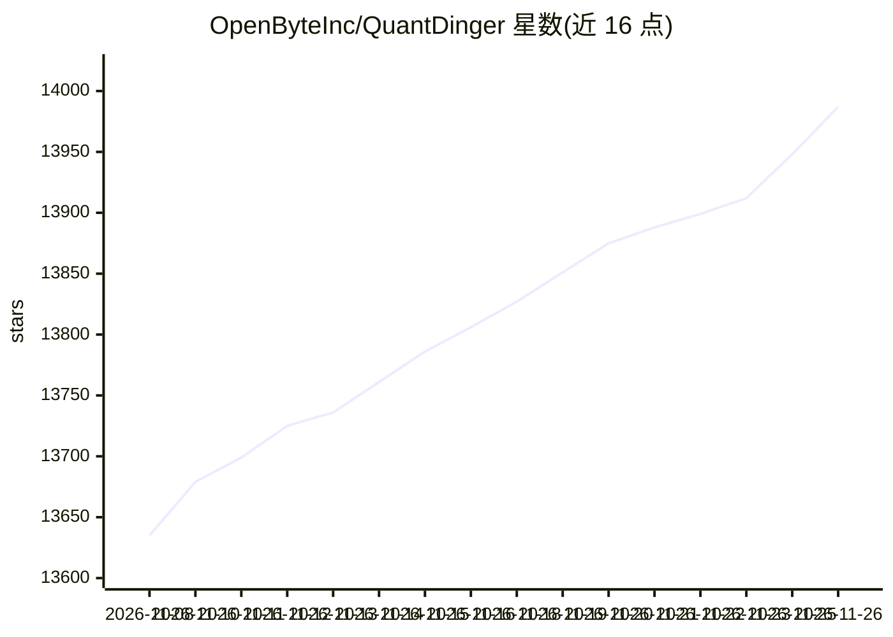

# OpenByteInc/QuantDinger

⭐ 13,987 · Python · Apache-2.0 · 推送 2026-11-25 · [GitHub](https://github.com/OpenByteInc/QuantDinger) · [官网](https://ai.quantdinger.com) · 组织维护 · 中文 README

**自托管开源 AI 量化交易平台：研究、回测到实盘执行**

QuantDinger 是 Open Byte Inc. 开发的开源自托管量化交易平台，面向独立交易者、Python 策略作者和小团队。核心流程覆盖 AI 市场研究、Python 策略开发（Strategy API V2）、因子实验室（含 IC 保留率与假发现控制）、服务端回测、模拟/实盘多资产执行、风控与监控。v5 后端按运行时边界组织：交易、调度、Celery 任务等进程分离，不可信策略代码在无凭据沙箱子进程中执行。通过 Docker Compose 或源码部署，数据与凭据保留在操作者本地。

## 筛选速览

| 维度 | 判定 | 备注 |
|---|---|---|
| AI 角色 | `ai-native` | 本体是模型或模型工具 |
| 许可风险 | `permissive` | Apache-2.0 |
| 部署形态 | `self-host` | docker 或自建部署 |
| 模型依赖 | — | README 未给出锁定关系 |
| 硬件要求 | — | 无带数字的原话,不猜 |
| 安装摩擦 | `low` | 无编译、无系统依赖或容器化 |
| 成熟度 | — | 结构信号不足 |

## 能力要点

- Factor Lab 支持最多 40 个因子基准测试，含 out-of-sample IC 与 Benjamini-Hochberg 假发现控制
- 策略进化搜索支持随机/网格/TPE 优化与 walk-forward 验证
- 不可信策略代码运行于无凭据沙箱子进程（资源限制与 Linux 内核隔离）
- Web、移动 H5、Human API、Agent Gateway 与 MCP 多种接入方式

## 适用场景

- 把交易想法转成 Python 策略并完成回测到实盘的闭环
- 本地自托管管理行情数据、策略代码与券商凭据
- 用因子实验室做因子筛选与稳健性检验
- 先在模拟/信号虚拟账户验证策略再考虑实盘

## 场景标签

`金融量化` `多智能体` · 领域:Agent 开发

## 证据(README 行号)

> L118: QuantDinger is an **open-source AI Trading OS** for independent traders, Python
> L125: - multi-provider AI market research and analysis;
> L130: - web, mobile H5, human API, Agent Gateway, and MCP access;

## 星数曲线

2026-11-08 13,635 → 2026-11-26 13,987（+352）

---
*卡片 v1 · prompt 1.4 · 生成 2026-11-22 · 置信度 mid · 依据 README sha `3645f181728d` · [字段定义](../../DATASET.md)*
