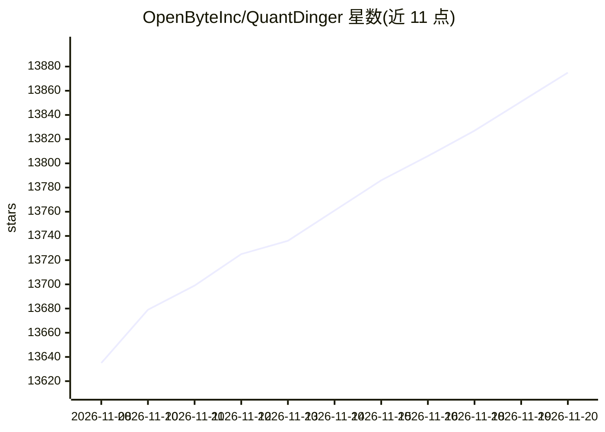

# OpenByteInc/QuantDinger

⭐ 13,875 · Python · Apache-2.0 · 推送 2026-11-19 · [GitHub](https://github.com/OpenByteInc/QuantDinger) · [官网](https://ai.quantdinger.com) · 组织维护 · 中文 README

**自托管开源 AI 量化交易 OS：研究、回测到实盘执行一体化**

面向独立交易者、Python 策略作者和小型团队的自托管 AI 交易操作系统。功能组合包括：多供应商 AI 市场研究、Python 指标与 Strategy API V2、服务端回测与实验工作流、加密交易所与传统经纪商的模拟盘与实盘执行、Web/移动 H5/Human API/Agent Gateway/MCP 接入，以及 PostgreSQL 状态存储、审计日志与可选监控。v5 后端以多进程 Docker Compose 架构运行，支持随机/网格/TPE 参数寻优、走前验证与多重稳健性检验。安装途径含 AWS Marketplace、一键脚本（预构建镜像）与源码 checkout，实盘需显式开启并自担风险，项目不提供投资建议。

## 筛选速览

| 维度 | 判定 | 备注 |
|---|---|---|
| AI 角色 | `ai-enhanced` | 去掉 AI 部分产品仍成立 |
| 许可风险 | `permissive` | Apache-2.0 |
| 部署形态 | `self-host` | docker 或自建部署 |
| 模型依赖 | — | README 未给出锁定关系 |
| 硬件要求 | — | 无带数字的原话,不猜 |
| 安装摩擦 | `low` | 无编译、无系统依赖或容器化 |
| 成熟度 | — | 结构信号不足 |

## 能力要点

- 多供应商 AI 市场研究与 MCP / Agent Gateway 接入
- Factor Lab 支持 40 个注册因子的时点面板基准测试（含 BH 假发现控制与样本外 IC 保留）
- 参数寻优配合 walk-forward 验证、PBO、Deflated Sharpe 与交易成本压力测试
- v5 多进程容器架构：交易 worker、Kafka 事件流、审计 worker 与 Prometheus 可观测性

## 适用场景

- 把交易想法写成 Python 策略并做回测与参数寻优
- 在自托管环境中同时管理加密货币与传统经纪商的模拟盘与实盘
- 通过 Web、API 或 MCP 让 AI agent 参与市场研究与策略迭代
- 以 Docker Compose 单机或分布式部署量化研究平台

## 场景标签

`金融量化` · 领域:学习与行业

## 证据(README 行号)

> L119: QuantDinger is an **open-source AI Trading OS** for independent traders, Python
> L126: - multi-provider AI market research and analysis;
> L129: - paper and live execution across crypto exchanges and traditional brokers;

## 星数曲线

2026-11-08 13,635 → 2026-11-20 13,875（+240）

---
*卡片 v1 · prompt 1.4 · 生成 2026-11-17 · 置信度 low · 依据 README sha `df828df2b60b` · [字段定义](../../DATASET.md)*
