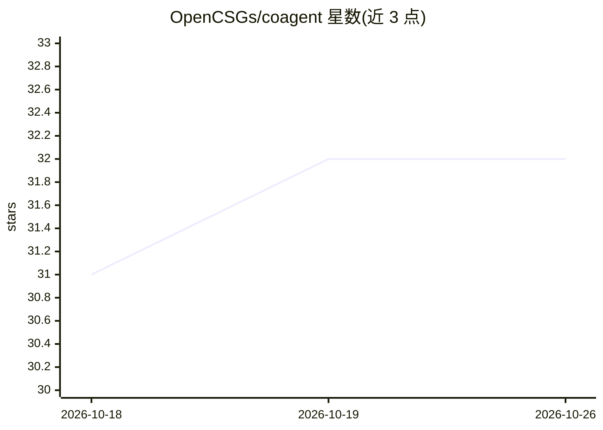

# OpenCSGs/coagent

⭐ 32 · Python · AGPL-3.0 · 推送 2026-01-14 · [GitHub](https://github.com/OpenCSGs/coagent) · 组织维护

**构建单体或分布式 agentic 系统的开源框架**

OpenCSGs 维护的 agent 框架，覆盖从简单 LLM 调用到组合式工作流与自主 agent。提供本地进程内、HTTP、NATS 三种运行时，支持单体或分布式部署；内置函数调用、结构化输出、ReAct agent、多 agent 编排（Triage/Handoffs/静态与动态编排）、Agent Discovery、A2A 与 MCP。模式参考 Anthropic 与 OpenAI 的 agent 设计文档，提供 chaining/parallelization/triaging/autonomous 等模式及可运行示例。以 pip 安装 Python 包为主，另支持 Node.js/Go，Zig/Rust 尚未实现；接入 LLM 需自行设置 API key。

## 筛选速览

| 维度 | 判定 | 备注 |
|---|---|---|
| AI 角色 | `ai-ecosystem` | LLM/agent 周边工具 |
| 许可风险 | `viral` | AGPL-3.0 |
| 部署形态 | `self-host` | docker 或自建部署 |
| 模型依赖 | locked-api |  |
| 硬件要求 | — | 无带数字的原话,不猜 |
| 安装摩擦 | `low` | 无编译、无系统依赖或容器化 |
| 成熟度 | — | 结构信号不足 |

## 能力要点

- 本地/HTTP/NATS 三种运行时，单体或分布式部署
- 单 agent（函数调用、结构化输出、ReAct）与多 agent 编排（Triage/Handoffs/Discovery）
- 支持 Model Context Protocol、A2A 与 LiteLLM 集成
- Python/Node.js/Go 多语言支持，附 chaining 等多种模式示例

## 适用场景

- 搭建从 LLM 调用到自主 agent 的应用
- 用 Triage/Handoffs 等模式编排多 agent 协作
- 通过 NATS 将 agent 部署为分布式服务并用 CLI 交互

## 场景标签

`Agent 框架` `多智能体` · 领域:Agent 开发

## 证据(README 行号)

> L4: An open-source framework for building monolithic or distributed agentic systems, ranging from simple LLM calls to co
> L35: - [x] Support any LLM

## 星数曲线

2026-10-18 31 → 2026-10-26 32（+1）

---
*卡片 v1 · prompt 1.4 · 生成 2026-10-26 · 置信度 mid · 依据 README sha `0a2217d6e53c` · [字段定义](../../DATASET.md)*
