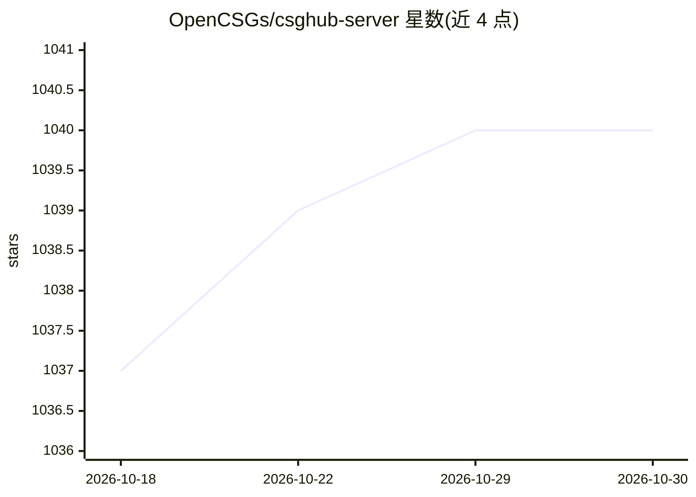

# OpenCSGs/csghub-server

⭐ 1,040 · Go · Apache-2.0 · 推送 2026-10-29 · [GitHub](https://github.com/OpenCSGs/csghub-server) · [官网](https://opencsg.com/models) · 组织维护 · 中文 README

**面向开发者的开源大模型资产平台 CSGHub 的后端服务**

CSGHub Server 是开源大模型资产管理平台 CSGHub 的后端组件，通过 REST API 管理模型、数据集及其他 LLM 资产。功能包括用户与组织管理、模型/数据集标签自动标注、搜索、数据集文件（如 .parquet）在线预览、文本与图片内容审核、含 LFS 在内的单文件下载，以及下载量与点赞等活动数据统计。架构上支持不同 git 服务器（Gitea、GitLab 等），LFS 存储可选本地或 S3 兼容云存储。要求 4c CPU/8GB 内存，通过 docker-compose 部署或 go run 本地启动，TOML 配置。

## 筛选速览

| 维度 | 判定 | 备注 |
|---|---|---|
| AI 角色 | `ai-ecosystem` | LLM/agent 周边工具 |
| 许可风险 | `permissive` | Apache-2.0 |
| 部署形态 | `None` |  |
| 模型依赖 | — | README 未给出锁定关系 |
| 硬件要求 | — | 无带数字的原话,不猜 |
| 安装摩擦 | `low` | 无编译、无系统依赖或容器化 |
| 成熟度 | — | 结构信号不足 |

## 能力要点

- REST API 管理模型、数据集与 LLM 资产
- 数据集文件（.parquet 等）在线预览与 LFS 文件下载
- 文本与图片内容审核，可选第三方审核服务
- 支持 Gitea/GitLab 等 git 服务器与 S3 兼容的 LFS 存储

## 适用场景

- 私有化部署团队自己的模型与数据集管理平台
- 通过 API 批量管理和检索 LLM 资产
- 跟踪模型与数据集的下载量等活动数据

## 场景标签

 · 领域:LLM 基础设施/资产管理平台

## 证据(README 行号)

> L3: `CSGHub Server` is a part of the open source and reliable large model assets management platform - CSGHub. It focuse
> L5: ## Key Features：

## 星数曲线

2026-10-18 1,037 → 2026-10-30 1,040（+3）

---
*卡片 v1 · prompt 1.4 · 生成 2026-10-21 · 置信度 high · 依据 README sha `36b59ff60c63` · [字段定义](../../DATASET.md)*
