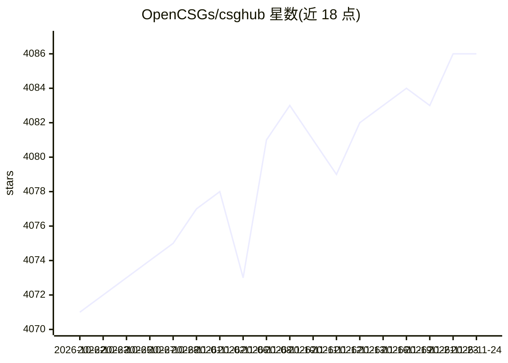

# OpenCSGs/csghub

⭐ 4,085 · Vue · Apache-2.0 · 推送 2026-11-13 · [GitHub](https://github.com/OpenCSGs/csghub) · [官网](https://opencsg.com) · 组织维护 · 中文 README

**面向企业的开源 LLM 资产管理平台，提供上传/下载/部署全流程**

CSGHub 是 OpenCSG 团队开发的用于管理 LLM 资产的开源平台，支持通过网页界面、git 命令行、自然语言 Chatbot 或 CSGHub SDK 对模型、数据集、Space、代码等资产进行上传、下载、存储、验证与分发。提供微服务子模块与标准化 OpenAPI 以便与现有系统集成，可 On-Premise 部署实现离线安全运行；同时提供开源版与 SaaS 版两种交付形态。文档提供 Docker Compose 与 Helm Chart 安装方式，支持阿里云市场一键部署。

## 筛选速览

| 维度 | 判定 | 备注 |
|---|---|---|
| AI 角色 | `ai-ecosystem` | LLM/agent 周边工具 |
| 许可风险 | `permissive` | Apache-2.0 |
| 部署形态 | `self-host` | docker 或自建部署 |
| 模型依赖 | — | README 未给出锁定关系 |
| 硬件要求 | — | 无带数字的原话,不猜 |
| 安装摩擦 | `low` | 无编译、无系统依赖或容器化 |
| 成熟度 | — | 结构信号不足 |

## 能力要点

- 支持网页、git 命令行、Chatbot 与 SDK 多种方式管理 LLM 资产
- 提供微服务子模块与标准化 OpenAPI 集成
- 支持 On-Premise 离线部署与多源数据同步
- 含数据处理与智能标注系统、Space 管理助手

## 适用场景

- 企业内网私有化部署自托管的模型/数据集资产管理平台
- 统一管理 LLM、数据集与 Agent 的全生命周期
- 通过 SDK 从私有平台拉取模型用于训练与推理部署

## 场景标签

 · 领域:LLM 基础设施/模型资产管理

## 证据(README 行号)

> L12: CSGHub is an open-source platform designed for managing Large Language Models (LLM) assets, offering an efficient w
> L14: Additionally, CSGHub features microservice submodules and standardized OpenAPIs for seamless integration with exist
> L41: - **For users seeking further practice:** Please refer to the CSGHub official documentation. The documentation curr

## 星数曲线

2026-10-22 4,071 → 2026-11-24 4,086（+15）

---
*卡片 v1 · prompt 1.4 · 生成 2026-11-23 · 置信度 high · 依据 README sha `f9a002fba9dd` · [字段定义](../../DATASET.md)*
