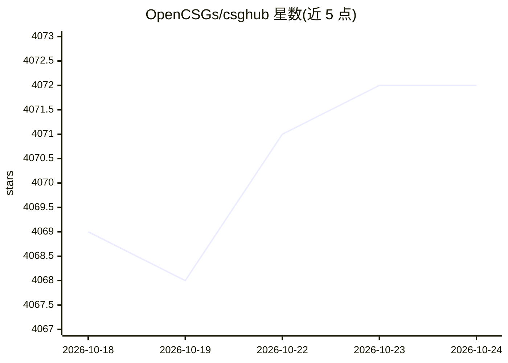

# OpenCSGs/csghub

⭐ 4,073 · Vue · Apache-2.0 · 推送 2026-10-15 · [GitHub](https://github.com/OpenCSGs/csghub) · [官网](https://opencsg.com) · 组织维护 · 中文 README

**开源 LLM 资产管理平台：模型/数据集/空间全生命周期管理**

OpenCSG 团队开发的开源平台，用于管理 LLM 及其资产（模型、数据集、Spaces、代码），支持上传、下载、存储、校验与分发，可通过 Web 界面、git 命令行、自然语言 Chatbot 或 SDK 访问。提供微服务子模块与标准化 OpenAPI 供系统集成，支持 On-Premise 离线部署，README 自述定位为可私有化部署的 Hugging Face 版本。安装途径为 Docker Compose 与 Helm Chart（见官方文档），另有免费 SaaS 版本。

## 筛选速览

| 维度 | 判定 | 备注 |
|---|---|---|
| AI 角色 | `ai-ecosystem` | LLM/agent 周边工具 |
| 许可风险 | `permissive` | Apache-2.0 |
| 部署形态 | `self-host` | docker 或自建部署 |
| 模型依赖 | — | README 未给出锁定关系 |
| 硬件要求 | — | 无带数字的原话,不猜 |
| 安装摩擦 | `low` | 无编译、无系统依赖或容器化 |
| 成熟度 | — | 结构信号不足 |

## 能力要点

- 模型/数据集/Spaces 等资产的统一管理与分发（Web、git、Chatbot、SDK 多通道）
- 微服务子模块与标准化 OpenAPI 支持与既有系统集成
- 支持 On-Premise 离线安全部署
- Python SDK 兼容 Hugging Face 生态（来自仓库描述）

## 适用场景

- 企业私有化部署模型与数据集资产仓库
- 通过 git 或 SDK 在流水线中分发 LLM 资产
- 在离线/内网环境统一管理 LLM 生命周期

## 场景标签

 · 领域:LLM 基础设施/资产管理

## 证据(README 行号)

> L12: CSGHub is an open-source platform designed for managing Large Language Models (LLM) assets, offering an efficient w
> L14: Additionally, CSGHub features microservice submodules and standardized OpenAPIs for seamless integration with exist

## 星数曲线

2026-10-18 4,069 → 2026-10-24 4,072（+3）

---
*卡片 v1 · prompt 1.4 · 生成 2026-10-20 · 置信度 high · 依据 README sha `3839b81657e0` · [字段定义](../../DATASET.md)*
