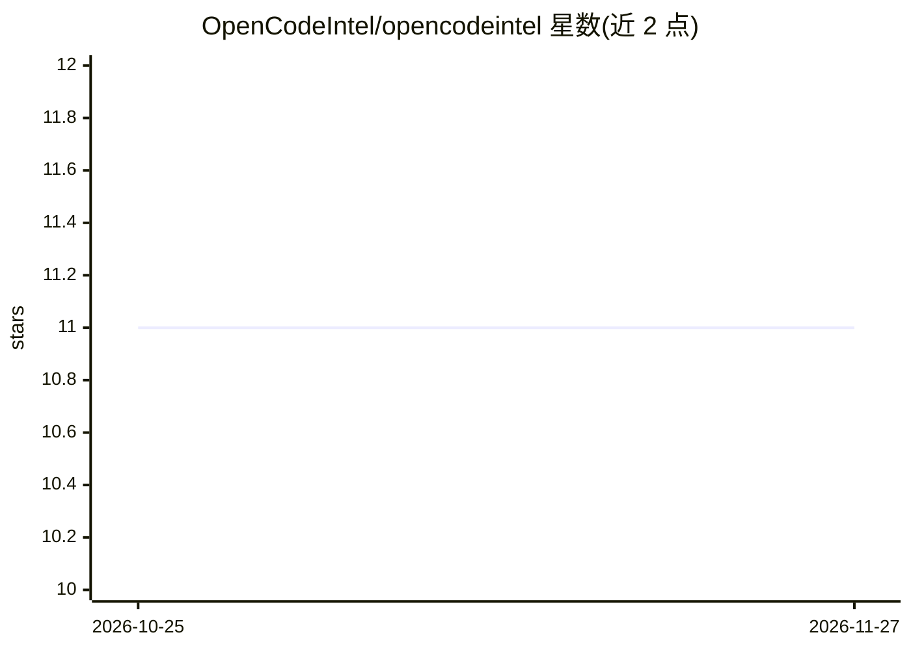

# OpenCodeIntel/opencodeintel

⭐ 11 · Python · MIT · 推送 2026-10-13 · [GitHub](https://github.com/OpenCodeIntel/opencodeintel) · [官网](https://opencodeintel.com) · 个人维护

**为开发者与 AI 编码代理提供语义代码搜索的平台**

面向接手陌生代码库的开发者，提供按含义而非关键词匹配的语义代码搜索：向量检索与 BM25 融合打分并经 reranker 重排，基于 tree-sitter AST 切块建立索引。平台包含 Web 应用、REST API 与 12 个工具的 MCP server，可接入 Claude Desktop/Cursor 为 AI 助手提供代码库上下文。附 WebGL 依赖图、影响分析、代码风格识别与回归评测。提供托管版与 Docker/手动两种自托管路径。

## 筛选速览

| 维度 | 判定 | 备注 |
|---|---|---|
| AI 角色 | `ai-native` | 本体是模型或模型工具 |
| 许可风险 | `permissive` | MIT |
| 部署形态 | `None` |  |
| 模型依赖 | locked-api |  |
| 硬件要求 | — | 无带数字的原话,不猜 |
| 安装摩擦 | `low` | 无编译、无系统依赖或容器化 |
| 成熟度 | — | 结构信号不足 |

## 能力要点

- 向量检索融合 BM25 与 rerank 的混合搜索，AST 切块索引
- 12 工具 MCP server，可接入 Claude Desktop 与 Cursor
- WebGL 依赖图、依赖结构矩阵、循环依赖检测与影响分析
- 发布检索研究实验数据与内部回归评测（backend/evals）

## 适用场景

- 接手陌生代码库时按功能描述定位相关代码
- 让 Claude/Cursor 获取整个代码库的真实上下文
- 改动前分析依赖影响面与团队代码风格约定

## 场景标签

`语义搜索` · 领域:知识与检索

## 证据(README 行号)

> L6:  Semantic code search powered by AI. Find anything, instantly.
> L59: ### Semantic Code Search
> L71: ### Works with Claude (MCP)

## 星数曲线

2026-10-25 11 → 2026-11-27 11（+0）

---
*卡片 v1 · prompt 1.4 · 生成 2026-11-19 · 置信度 high · 依据 README sha `e717d9264cf4` · [字段定义](../../DATASET.md)*
