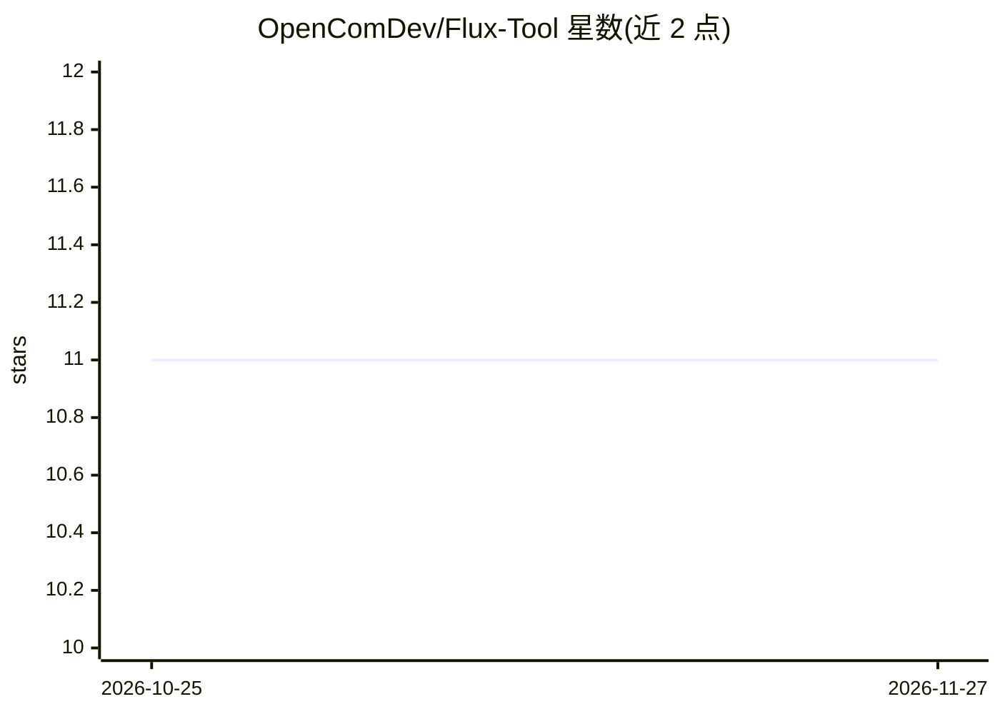

# OpenComDev/Flux-Tool

⭐ 11 · JavaScript · 推送 2025-12-09 · [GitHub](https://github.com/OpenComDev/Flux-Tool) · [官网](https://fluxtool.io/) · 组织维护

**面向创作者与团队的多模态 AI 内容生成一体化平台**

Flux Tool 是一个可扩展的多模态 AI 平台，将文本写作、图像/视频生成、语音合成、代码辅助与商业内容工具整合到统一工作区。通过对接 OpenAI GPT-4、Claude、Stability AI、ElevenLabs、Whisper 等模型 API 提供生成能力，内置 Agent Builder（带记忆与人格）、文件对话与可部署 Web 聊天机器人。前端 React，后端 Node.js/Express 与 Python FastAPI，可用 Docker Compose 部署，提供 MIT 许可、公开 API/SDK（文档标注 Coming Soon）。

## 筛选速览

| 维度 | 判定 | 备注 |
|---|---|---|
| AI 角色 | `ai-native` | 本体是模型或模型工具 |
| 许可风险 | `none` | — |
| 部署形态 | `self-host` | docker 或自建部署 |
| 模型依赖 | — | README 未给出锁定关系 |
| 硬件要求 | — | 无带数字的原话,不猜 |
| 安装摩擦 | `low` | 无编译、无系统依赖或容器化 |
| 成熟度 | — | 结构信号不足 |

## 能力要点

- 文本/图像/视频/语音/代码多模态生成工具集
- 带记忆与人格的 Agent Builder 与 Web Chatbot 部署
- 文件对话支持 PDF/DOC/PPT/Excel
- 提供公开 API 与 SDK（API key 鉴权）

## 适用场景

- 批量生成博客、广告文案与社交媒体内容
- 搭建可部署到网页的定制聊天机器人
- 为品牌生成配音、克隆与多语言语音

## 场景标签

`聊天机器人` `AI 写作` `语音合成` `视频生成` · 领域:对话与助手

## 证据(README 行号)

> L3: **Flux Tool** is an extensible, multimodal AI platform built for crators, developers, businesses, and teams to build
> L57: - **AI Models:** OpenAI GPT-4, Claude, Stability AI, ElevenLabs, Whisper

## 星数曲线

2026-10-25 11 → 2026-11-27 11（+0）

---
*卡片 v1 · prompt 1.4 · 生成 2026-11-19 · 置信度 mid · 依据 README sha `f88da766069c` · [字段定义](../../DATASET.md)*
