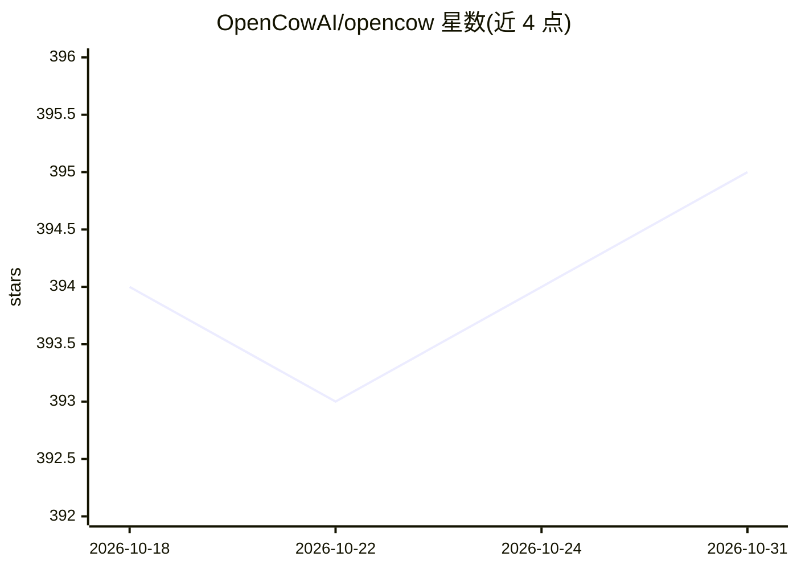

# OpenCowAI/opencow

⭐ 395 · TypeScript · Apache-2.0 · 推送 2026-05-11 · [GitHub](https://github.com/OpenCowAI/opencow) · [官网](https://opencow.ai) · 组织维护 · 中文 README

**任务驱动自主 AI 智能体平台：一任务一智能体并行交付**

基于 Electron/React/TypeScript 的开源桌面平台，将任务清单中的每个任务指派一个专属自主 AI 智能体，自动研究、起草、构建并发布成果，支持 15+ 智能体并行、实时监控与审批门。内置技能/知识库/4 层上下文引擎，可从 Telegram、Discord、微信、飞书调度智能体。AI 引擎采用 Claude Agent SDK 与 Codex SDK 加 MCP，多引擎可选。全部本地运行、零遥测。

## 筛选速览

| 维度 | 判定 | 备注 |
|---|---|---|
| AI 角色 | `ai-native` | 本体是模型或模型工具 |
| 许可风险 | `permissive` | Apache-2.0 |
| 部署形态 | `desktop` | 安装包/桌面程序 |
| 模型依赖 | locked-api |  |
| 硬件要求 | — | 无带数字的原话,不猜 |
| 安装摩擦 | `low` | 无编译、无系统依赖或容器化 |
| 成熟度 | — | 结构信号不足 |

## 能力要点

- 1 任务=1 智能体，15+ 智能体并行交付，支持挂起恢复
- Telegram/Discord/微信/飞书 4 平台 IM 调度与定时任务
- Claude Agent SDK + Codex SDK + MCP 多引擎可选
- 本地私有运行，零遥测零云端，SQLite 本地存储

## 适用场景

- 把项目拆成子任务，由多个 AI 智能体并行产出报告/功能/审计
- 在 IM 里用自然语言派发任务并接收进度通知
- 通过仪表盘审批各智能体的交付物

## 场景标签

`多智能体` · 领域:Agent 开发

## 证据(README 行号)

> L10: Every task becomes an autonomous agent — campaigns, reports, features, audits
> L116: |**AI**|Claude Agent SDK + Codex SDK + MCP|Multi-engine — choose Claude or Codex as your AI engine, with Model Con

## 星数曲线

2026-10-18 394 → 2026-10-31 395（+1）

---
*卡片 v1 · prompt 1.4 · 生成 2026-10-21 · 置信度 mid · 依据 README sha `a71fc5878af4` · [字段定义](../../DATASET.md)*
