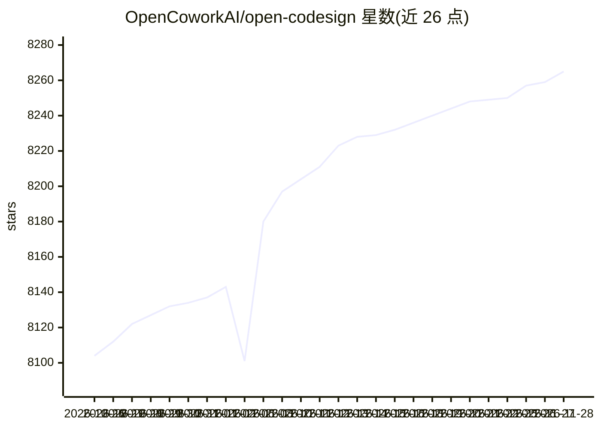

# OpenCoworkAI/open-codesign

⭐ 8,265 · TypeScript · MIT · 推送 2026-11-27 · [GitHub](https://github.com/OpenCoworkAI/open-codesign) · [官网](https://opencoworkai.github.io/open-codesign/) · 组织维护 · 中文 README

**本地优先桌面应用：把提示词生成为原型/幻灯片/PDF**

MIT 许可的 Electron 桌面应用，将提示词转换为原型、幻灯片、PDF 等产物，运行在本地笔记本上。通过 BYOK 使用用户已有的模型密钥或订阅：支持粘贴 Anthropic/OpenAI/Gemini/DeepSeek/OpenRouter 等密钥、ChatGPT 订阅登录使用 Codex 模型、一键导入 Claude Code / Codex 配置，或连接本地 Ollama 与任意 OpenAI 兼容端点。生成过程含 agent 规划、工具调用可视化、可中断运行与本地会话保存；导出 HTML/PDF/PPTX/ZIP/Markdown 真实文件。要求 macOS 12+/Windows 10+/Linux glibc≥2.31，安装包目前未签名公证。

## 筛选速览

| 维度 | 判定 | 备注 |
|---|---|---|
| AI 角色 | `ai-native` | 本体是模型或模型工具 |
| 许可风险 | `permissive` | MIT |
| 部署形态 | `desktop` | 安装包/桌面程序 |
| 模型依赖 | local-ok | 支持本地模型 |
| 硬件要求 | — | 无带数字的原话,不猜 |
| 安装摩擦 | `medium` | 含编译或系统依赖之一 |
| 成熟度 | — | 结构信号不足 |

## 能力要点

- BYOK 多模型：Claude/GPT/Gemini/DeepSeek/Kimi/GLM/Ollama 及 OpenAI 兼容端点
- 本地优先：凭据存于本机 config.toml，无强制云端工作区
- 点击元素打 pin 让模型重写该区域，AI 调节的参数滑杆
- 导出真实文件 HTML/PDF/PPTX/ZIP/Markdown，本地版本历史

## 适用场景

- 用已有 API 密钥在本地把提示词变成可交互原型
- 无订阅锁定地生成幻灯片与营销素材
- 需要本地保存设计迭代历史与可编辑导出的设计流程

## 场景标签

`代码生成` · 领域:编码与开发

## 证据(README 行号)

> L32: Turn a prompt into a polished prototype, slide deck, or marketing asset, locally, with the model you already use.
> L34: **Open CoDesign is the open-source Claude Design alternative** — built for people who want the speed of AI-native d
> L185: - **API key** — paste Anthropic (`sk-ant-...`), OpenAI (`sk-...`), Atlas Cloud, LLMTR, Google Gemini, OpenRouter, 

## 星数曲线

2026-10-26 8,104 → 2026-11-28 8,265（+161）

---
*卡片 v1 · prompt 1.4 · 生成 2026-11-28 · 置信度 high · 依据 README sha `64988b5156c3` · [字段定义](../../DATASET.md)*
