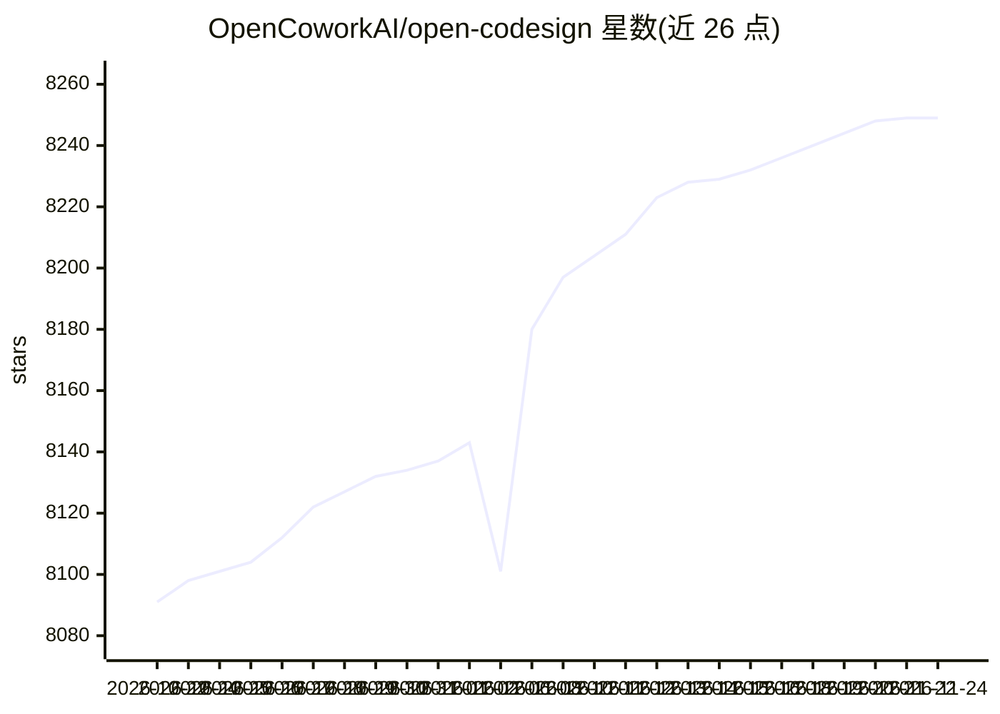

# OpenCoworkAI/open-codesign

⭐ 8,250 · TypeScript · MIT · 推送 2026-11-21 · [GitHub](https://github.com/OpenCoworkAI/open-codesign) · [官网](https://opencoworkai.github.io/open-codesign/) · 组织维护 · 中文 README

**开源桌面 AI 设计工具：提示词生原型/幻灯/PDF，BYOK 多模型**

Electron 桌面应用，将提示词转为原型、幻灯片、营销素材与可导出文件（HTML/PDF/PPTX/ZIP/Markdown），本地运行、MIT 许可。通过 BYOK 接入 Claude、GPT、Gemini、DeepSeek、Kimi、GLM、Ollama 或任意 OpenAI 兼容端点，也支持 ChatGPT 订阅登录使用 Codex 模型，并可一键导入已有的 Claude Code / Codex 配置。生成过程由 agent 规划、写文件、自检，提供活动面板、可中断生成、元素点选局部改写、参数滑杆微调、本地会话版本留存。安装包未签名/公证，macOS Sequoia 需手动放行。

## 筛选速览

| 维度 | 判定 | 备注 |
|---|---|---|
| AI 角色 | `ai-native` | 本体是模型或模型工具 |
| 许可风险 | `permissive` | MIT |
| 部署形态 | `desktop` | 安装包/桌面程序 |
| 模型依赖 | local-ok | 支持本地模型 |
| 硬件要求 | — | 无带数字的原话,不猜 |
| 安装摩擦 | `medium` | 含编译或系统依赖之一 |
| 成熟度 | — | 结构信号不足 |

## 能力要点

- BYOK 多模型：Claude、GPT、Gemini、DeepSeek、Kimi、GLM、Ollama 及 OpenAI 兼容端点
- 支持 ChatGPT 订阅登录使用 Codex 模型，一键导入 Claude Code / Codex 配置
- agent 生成过程可见、可中断，支持元素级 pin 局部改写与参数滑杆
- 导出 HTML、PDF、PPTX、ZIP、Markdown，数据本地存储

## 适用场景

- 用提示词快速生成网页原型和设计稿
- 本地生成幻灯片和营销素材并导出 PPTX/PDF
- 已有 Claude Code 或 Codex key 的开发者复用现有配置做设计

## 场景标签

`代码生成` `AI 写作` · 领域:编码与开发

## 证据(README 行号)

> L34: **Open CoDesign is the open-source Claude Design alternative** — built for people who want the speed of AI-native d
> L91: |Open source|✅ MIT|❌ Closed|❌ Closed|❌ Closed|

## 星数曲线

2026-10-22 8,091 → 2026-11-24 8,249（+158）

---
*卡片 v1 · prompt 1.4 · 生成 2026-11-22 · 置信度 high · 依据 README sha `1e3b05d6c4c6` · [字段定义](../../DATASET.md)*
