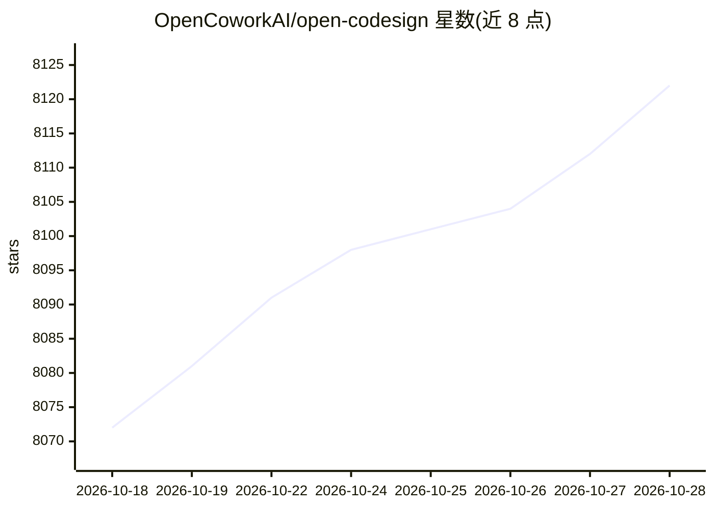

# OpenCoworkAI/open-codesign

⭐ 8,127 · TypeScript · MIT · 推送 2026-10-28 · [GitHub](https://github.com/OpenCoworkAI/open-codesign) · [官网](https://opencoworkai.github.io/open-codesign/) · 组织维护 · 中文 README

**本地优先的开源 AI 设计桌面应用：提示词生成原型/幻灯/PDF**

MIT 许可的 Electron 桌面应用，将提示词转化为原型、幻灯片、营销素材等产物，支持导出 HTML/PDF/PPTX/ZIP/Markdown。采用 BYOK 模式，可用 Claude、GPT、Gemini、DeepSeek、Kimi、GLM、Ollama、OpenRouter 等 20+ 模型或任意 OpenAI 兼容端点，也可一键导入 Claude Code/Codex 既有配置或 ChatGPT 订阅登录。生成过程可见 agent 待办与工具调用、可中断；支持元素级批注重写、AI 微调滑杆、本地设计中心与版本历史。安装包目前未签名，macOS Sequoia 15+ 需手动执行 xattr 命令绕过 Gatekeeper。

## 筛选速览

| 维度 | 判定 | 备注 |
|---|---|---|
| AI 角色 | `ai-native` | 本体是模型或模型工具 |
| 许可风险 | `permissive` | MIT |
| 部署形态 | `desktop` | 安装包/桌面程序 |
| 模型依赖 | local-ok | 支持本地模型 |
| 硬件要求 | — | 无带数字的原话,不猜 |
| 安装摩擦 | `medium` | 含编译或系统依赖之一 |
| 成熟度 | — | 结构信号不足 |

## 能力要点

- 提示词生成交互原型/幻灯/PDF，导出 HTML/PDF/PPTX/ZIP/Markdown
- BYOK 支持 20+ 模型及任意 OpenAI 兼容端点，一键导入 Claude Code/Codex 配置
- 生成过程实时可见 agent 待办与工具调用，可中断、可队列追加指令
- 元素级批注局部重写与 AI 微调滑杆（颜色/间距/排版）

## 适用场景

- 用自己已有的 API key 或订阅在本地生成网页原型和幻灯片
- 不订阅云端设计工具，离线完成 prompt 到产物的设计流程
- 对生成结果做元素级批注修改而非整页重生成

## 场景标签

`代码生成` `AI 写作` · 领域:编码与开发

## 证据(README 行号)

> L32: Turn a prompt into a polished prototype, slide deck, or marketing asset, locally, with the model you already use.
> L34: **Open CoDesign is the open-source Claude Design alternative** — built for people who want the speed of AI-native d
> L74: From a blank prompt to a finished artifact, the agent plans, writes, self-checks, and ships something with hover st

## 星数曲线

2026-10-18 8,072 → 2026-10-28 8,122（+50）

---
*卡片 v1 · prompt 1.4 · 生成 2026-10-20 · 置信度 high · 依据 README sha `f3948cd36567` · [字段定义](../../DATASET.md)*
