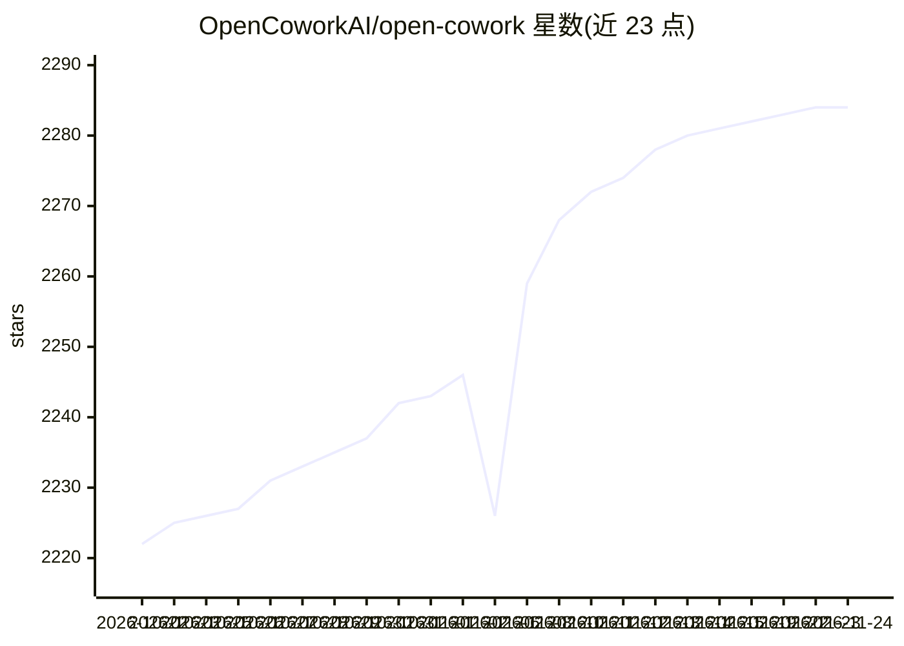

# OpenCoworkAI/open-cowork

⭐ 2,284 · TypeScript · MIT · 推送 2026-10-20 · [GitHub](https://github.com/OpenCoworkAI/open-cowork) · [官网](https://github.com/OpenCoworkAI/open-cowork) · 组织维护 · 中文 README

**普通用户可一键安装的 AI agent 桌面应用（Win/macOS）**

Electron 桌面应用，将 Claude、OpenAI 兼容 API、GLM 等模型封装进图形界面，免代码配置 API Key 即可运行 agent。提供沙箱隔离（Windows 走 WSL2、macOS 走 Lima 虚拟机，无 VM 时回退到路径限制）、内置 PPTX/DOCX/XLSX/PDF 文档生成 Skills、MCP 连接器（浏览器、Notion 等）、GUI 自动化操作，以及通过飞书/Slack 远程控制。支持自定义 Skill，操作轨迹面板可查看推理与工具执行过程。

## 筛选速览

| 维度 | 判定 | 备注 |
|---|---|---|
| AI 角色 | `ai-native` | 本体是模型或模型工具 |
| 许可风险 | `permissive` | MIT |
| 部署形态 | `desktop` | 安装包/桌面程序 |
| 模型依赖 | locked-api |  |
| 硬件要求 | — | 无带数字的原话,不猜 |
| 安装摩擦 | `low` | 无编译、无系统依赖或容器化 |
| 成熟度 | — | 结构信号不足 |

## 能力要点

- 三级沙箱：路径限制 + WSL2/Lima VM 级隔离，命令在隔离环境执行
- 内置 Skills 系统生成 PPTX/DOCX/PDF/XLSX，支持自定义创建
- MCP 连接器接入浏览器、Notion 等外部服务
- 多模型配置：OpenRouter/Anthropic 及 GLM、MiniMax、Kimi，含 GUI 自动化与飞书/Slack 远程控制

## 适用场景

- 不写代码在桌面跑 AI agent 处理文件、生成 PPT/表格
- 让 AI 在虚拟机沙箱内安全地操作本地文件
- 通过飞书/Slack 远程给家中电脑的 agent 下指令
- 接入 Notion、浏览器等桌面应用扩展 agent 能力

## 场景标签

`GUI 自动化` `AI 助手` · 领域:效率与自动化

## 证据(README 行号)

> L20: Open Cowork is a free, open-source AI agent desktop application for Windows and macOS. It wraps Claude Code, OpenAI
> L39: - **One-Click Install, Ready to Use**: Pre-built installers for Windows and macOS, no environment setup needed—just
> L49: - **VM-Level Isolation**: WSL2 (Windows) and Lima (macOS) VM isolation—all commands execute in an isolated VM to pr

## 星数曲线

2026-10-22 2,222 → 2026-11-24 2,284（+62）

---
*卡片 v1 · prompt 1.4 · 生成 2026-11-23 · 置信度 high · 依据 README sha `0071b79006d3` · [字段定义](../../DATASET.md)*
