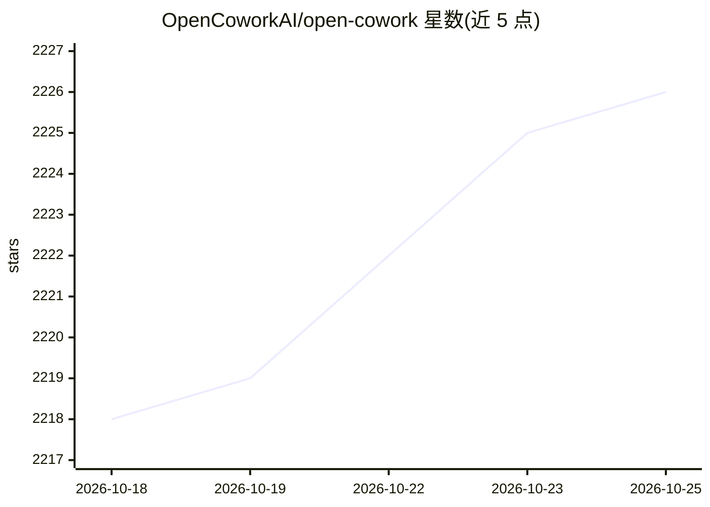

# OpenCoworkAI/open-cowork

⭐ 2,226 · TypeScript · MIT · 推送 2026-10-20 · [GitHub](https://github.com/OpenCoworkAI/open-cowork) · [官网](https://github.com/OpenCoworkAI/open-cowork) · 组织维护 · 中文 README

**给普通用户的开源 AI agent 桌面应用，一键安装多模型办公自动化**

面向 Windows/macOS 用户的 Electron 桌面应用，把 Claude Code、OpenAI、Gemini、DeepSeek、GLM、MiniMax、Kimi 等模型封装进 GUI，无需命令行即可使用。提供内置 Skills 系统生成 PPTX/DOCX/XLSX/PDF、MCP 连接器接入浏览器与 Notion、GUI 自动化操作、飞书/Slack 远程控制，以及 WSL2/Lima VM 级沙箱隔离。MIT 许可，应用本身免费，模型 API 费用自理；Linux 需从源码构建。

## 筛选速览

| 维度 | 判定 | 备注 |
|---|---|---|
| AI 角色 | `ai-native` | 本体是模型或模型工具 |
| 许可风险 | `permissive` | MIT |
| 部署形态 | `desktop` | 安装包/桌面程序 |
| 模型依赖 | locked-api |  |
| 硬件要求 | — | 无带数字的原话,不猜 |
| 安装摩擦 | `low` | 无编译、无系统依赖或容器化 |
| 成熟度 | — | 结构信号不足 |

## 能力要点

- 内置 Skills 生成 PPTX/DOCX/XLSX/PDF，支持自定义技能
- MCP 连接器接入浏览器、Notion 等外部服务
- WSL2 (Windows)/Lima (macOS) VM 级沙箱隔离
- 飞书 (Lark) 与 Slack 远程控制

## 适用场景

- 不写代码就让我读财报 CSV 并生成 PowerPoint 摘要
- 让 AI agent 在沙箱里管理文件和操作桌面 GUI 应用
- 通过飞书或 Slack 远程向本机 agent 下达指令

## 场景标签

`GUI 自动化` `编码 Agent` `AI 助手` · 领域:效率与自动化

## 证据(README 行号)

> L20: Open Cowork is a free, open-source AI agent desktop application for Windows and macOS. It wraps Claude Code, OpenAI
> L202: Open Cowork is a free, open-source desktop application that provides a local AI agent workspace. It wraps AI model
> L204: **How is Open Cowork different from Claude Cowork?**

## 星数曲线

2026-10-18 2,218 → 2026-10-25 2,226（+8）

---
*卡片 v1 · prompt 1.4 · 生成 2026-10-21 · 置信度 high · 依据 README sha `72a0df4ba813` · [字段定义](../../DATASET.md)*
