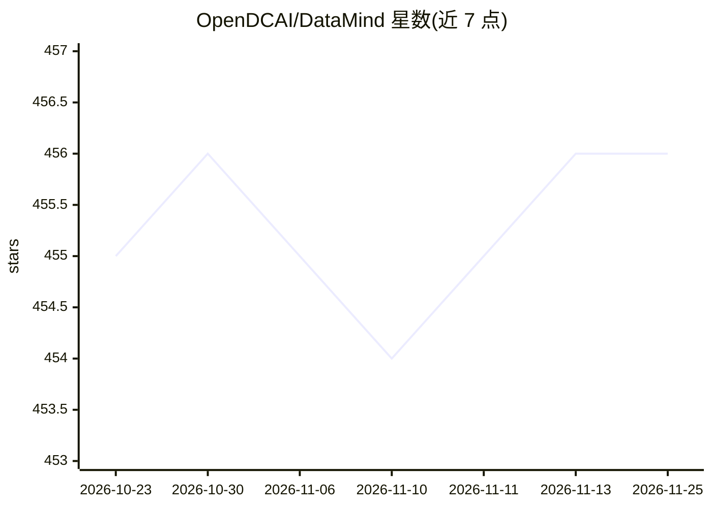

# OpenDCAI/DataMind

⭐ 456 · Python · Apache-2.0 · 推送 2026-10-23 · [GitHub](https://github.com/OpenDCAI/DataMind) · [官网](https://opendcai.github.io/DataMind-Doc) · 组织维护 · 中文 README

**为 Codex agent 提供共享工作区数据层的插件**

DataMind 定位为 Codex 主 agent 的共享数据层：存储数据、执行工具、返回证据与写入回执，而推理、摄取与检索由 Codex 完成。提供五个功能面：KB 语义检索、SQL 精确查询、图谱（NetworkX+JSON 本地后端）、版本化 Skills、Memory。插件、官方 Codex SDK 集成、CLI、HTTP API 与浏览器 UI 共享同一数据层；工作区通过不可变修订、源检查点与 compare-and-swap 发布保证一致读。2.0 已移除内置 StoreAgent/RetrieveAgent 与 Claude SDK 适配器。Apache 2.0 许可。

## 筛选速览

| 维度 | 判定 | 备注 |
|---|---|---|
| AI 角色 | `ai-ecosystem` | LLM/agent 周边工具 |
| 许可风险 | `permissive` | Apache-2.0 |
| 部署形态 | `library` | 以包/库形式分发 |
| 模型依赖 | — | README 未给出锁定关系 |
| 硬件要求 | — | 无带数字的原话,不猜 |
| 安装摩擦 | `low` | 无编译、无系统依赖或容器化 |
| 成熟度 | — | 结构信号不足 |

## 能力要点

- KB/SQL/Graph/Skills/Memory 五个数据面，统一数据层
- 工作区不可变修订与源版本校验（SHA-256），支持历史回滚
- 插件、Codex SDK、CLI、HTTP API、UI 五种接入面共享数据层
- 写入回执与 operation_id 一致读机制

## 适用场景

- 让本地 Codex agent 摄取文件夹并基于工作区数据回答问题
- 企业通过官方 Codex SDK 集成数据层到自有应用
- 通过 CLI 或 HTTP API 对工作区做只读问答与授权写入

## 场景标签

`知识图谱` `语义搜索` `Agent 记忆` · 领域:Agent 开发

## 证据(README 行号)

> L3: **The shared workspace data layer for Codex.** Codex reasons, ingests and retrieves;
> L4: DataMind stores data, executes tools, and returns evidence and write receipts.
> L17: The plugin, official Codex SDK integration, CLI, HTTP API and browser UI share

## 星数曲线

2026-10-23 455 → 2026-11-25 456（+1）

---
*卡片 v1 · prompt 1.4 · 生成 2026-11-25 · 置信度 high · 依据 README sha `2284d65bb302` · [字段定义](../../DATASET.md)*
