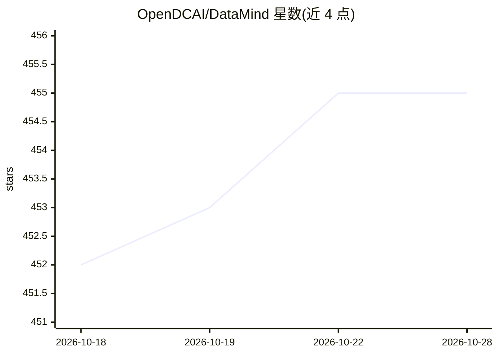

# OpenDCAI/DataMind

⭐ 455 · Python · Apache-2.0 · 推送 2026-10-23 · [GitHub](https://github.com/OpenDCAI/DataMind) · [官网](https://opendcai.github.io/DataMind-Doc) · 组织维护 · 中文 README

**为 Codex 提供共享工作区数据层的插件：存储、工具执行与证据回执**

作为 Codex 的数据层插件运行：Codex 负责推理、摄取与检索，DataMind 负责存储数据、执行数据工具并返回证据与写入回执。提供 KB 语义检索、SQL 只读查询、类型化图存储（NetworkX+JSON 本地后端）、版本化 Skills 与 Memory 五种能力面，通过 Codex 插件、官方 Codex SDK、CLI、HTTP API 与浏览器 UI 共用同一数据层。2.0 已移除旧 StoreAgent/RetrieveAgent 与 Claude SDK 后端。本地协调器支持 SQLite/NetworkX/Chroma/LanceDB，不承诺分布式协调。

## 筛选速览

| 维度 | 判定 | 备注 |
|---|---|---|
| AI 角色 | `ai-ecosystem` | LLM/agent 周边工具 |
| 许可风险 | `permissive` | Apache-2.0 |
| 部署形态 | `library` | 以包/库形式分发 |
| 模型依赖 | — | README 未给出锁定关系 |
| 硬件要求 | — | 无带数字的原话,不猜 |
| 安装摩擦 | `low` | 无编译、无系统依赖或容器化 |
| 成熟度 | — | 结构信号不足 |

## 能力要点

- KB/SQL/Graph/Skills/Memory 五个数据能力面，统一 operation_id 下的快照一致性读取
- 写入带证据与回执，发布为不可变修订，可检查或回滚
- 独立 MCP 传输随 wheel 安装（python -m datamind.mcp）
- Codex 插件、SDK、CLI、HTTP API 与 UI 共享同一数据层

## 适用场景

- 为本地 Codex 配置带审计回执的工作区数据层
- 企业侧通过官方 Codex SDK 集成问答与授权写入
- 对 KB/SQL/图数据做带版本快照的检索与回滚

## 场景标签

`知识图谱` `语义搜索` `Agent 记忆` · 领域:Agent 开发

## 证据(README 行号)

> L3: **The shared workspace data layer for Codex.** Codex reasons, ingests and retrieves;
> L18: the same data layer. Codex is the main agent for ingestion and retrieval.

## 星数曲线

2026-10-18 452 → 2026-10-28 455（+3）

---
*卡片 v1 · prompt 1.4 · 生成 2026-10-21 · 置信度 high · 依据 README sha `cdbc6130ee29` · [字段定义](../../DATASET.md)*
