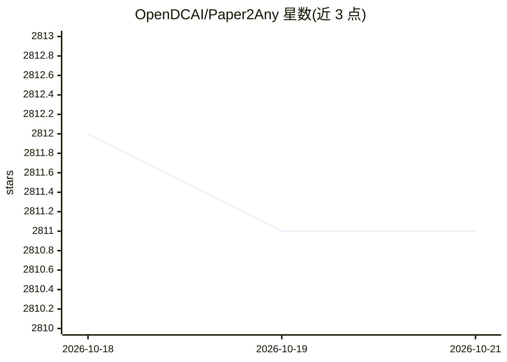

# OpenDCAI/Paper2Any

⭐ 2,811 · Python · Apache-2.0 · 推送 2026-08-31 · [GitHub](https://github.com/OpenDCAI/Paper2Any) · [官网](https://paper2any-studio.cpolar.cn/) · 组织维护 · 中文 README

**论文/文本转可编辑科研图表、技术路线图与演示文稿的 AI 工作区**

Paper2Any 将论文 PDF、图片或文本经 Agent 流程转换为可编辑的 PPTX 图表、技术路线图（PPT+SVG）、draw.io 图、幻灯片、学术海报、视频脚本等产出，另含 PDF2PPT 版式保留转换、Image2PPT、图像模型 Playground 与 PPT 美化。面向科研用户与需要从文献快速产出可编辑交付物的使用者。README 声明本仓库为 Apache-2.0 遗留快照，不再同步新功能；活跃开发的是托管版 Nexus Office，其实现未在本仓库分发。提供在线 Demo。

## 筛选速览

| 维度 | 判定 | 备注 |
|---|---|---|
| AI 角色 | `ai-native` | 本体是模型或模型工具 |
| 许可风险 | `permissive` | Apache-2.0 |
| 部署形态 | `desktop` | 安装包/桌面程序 |
| 模型依赖 | local-ok | 支持本地模型 |
| 硬件要求 | `cpu-ok` | |
| 安装摩擦 | `medium` | 含编译或系统依赖之一 |
| 成熟度 | — | 结构信号不足 |

## 能力要点

- 论文/文本/图片到可编辑 PPTX 图表、幻灯片、海报、draw.io 图的多路线生成
- PDF2PPT 版式保留转换与 PPTPolish AI 美化
- 三层模型配置系统，支持 GPT-4o、Qwen-VL 动态选择
- 本地浏览器交互式抠图，不消耗图像生成额度（Nexus Office）

## 适用场景

- 把论文 PDF 转成可编辑的组会汇报幻灯片
- 从论文生成技术路线图和模型架构图用于 PPT
- 将会议记录整理为可编辑 DOCX 报告（Nexus Office）

## 场景标签

`科研工具` · 领域:学习与行业

## 证据(README 行号)

> L4:  Give an Agent a goal, your files, and a few constraints. Get back editable PowerPoint, Excel, Word, and visual asse
> L204: > From paper PDFs / images / text to **editable** scientific figures, slide decks, video scripts, academic posters

## 星数曲线

2026-10-18 2,812 → 2026-10-21 2,811（-1）

---
*卡片 v1 · prompt 1.4 · 生成 2026-10-21 · 置信度 mid · 依据 README sha `23da984544db` · [字段定义](../../DATASET.md)*
